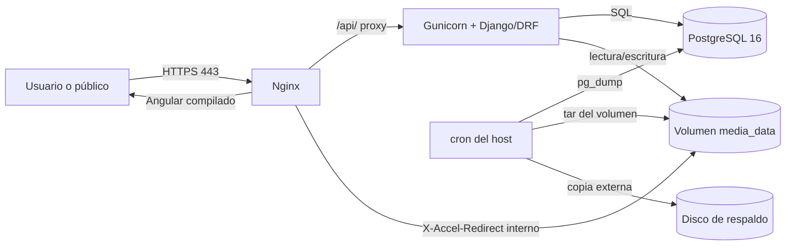
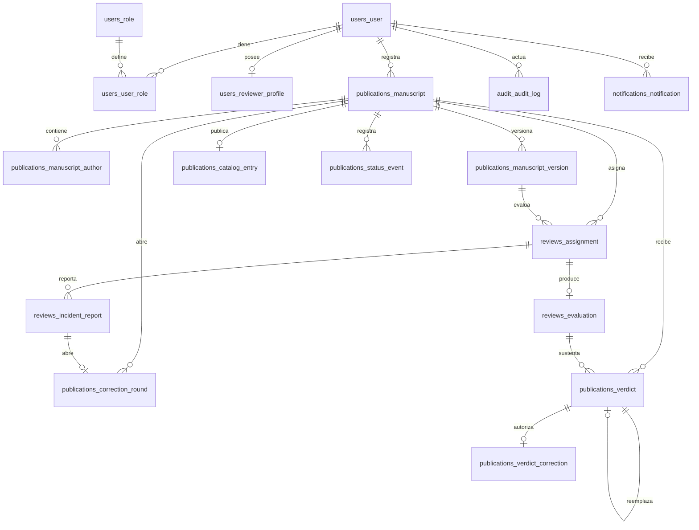

# Plan de Implementación — Sistema de Gestión de Publicaciones Científicas

**Rama:** `001-manuscript-review-workflow`  
**Fecha:** 22 de octubre de 2026  
**Especificación:** `.spec-kit/specify.md`  
**Constitución:** `.spec-kit/constitution.md`  
**Clarificaciones:** `.spec-kit/clarify.md`  
**Estado:** Arquitectura técnica lista para ejecución  
**Alcance:** Fase 1. El ranking automatizado de revisores de la Fase 2 queda explícitamente fuera de este plan.

---

## Resumen

Se implementará una aplicación web cliente-servidor con Angular como SPA y Django + Django REST Framework como API. La persistencia será PostgreSQL. Todo el entorno se orquestará con Docker Compose sobre un único servidor Linux on-premise para el piloto académico.

La arquitectura se apoya en cuatro decisiones cerradas:

1. Los PDF originales y las copias sanitizadas se guardan en un volumen persistente local de Docker.
2. El límite es de 50 MB por PDF, con 60 MB de límite de request en Nginx.
3. Nginx sirve Angular, termina TLS, aplica los límites de carga y entrega los PDF mediante `X-Accel-Redirect` después de que Django autorice la solicitud.
4. Un script local ejecuta el respaldo diario de PostgreSQL y del volumen de PDF, con retención de 30 días y prueba mensual de restauración.

El diseño prioriza la trazabilidad y el doble ciego: cada envío formal crea una versión inmutable con el PDF exacto, su sello SHA-256 y una instantánea canónica de los metadatos. Los revisores solo acceden a la versión asignada, a una copia sanitizada y a serializadores que nunca incluyen identidad autoral.

---

## Contexto técnico

| Elemento | Decisión |
|---|---|
| Backend | Python 3.12, Django 5.2 LTS, Django REST Framework 3.15 |
| Autenticación | JWT con `djangorestframework-simplejwt`; roles revalidados contra base de datos en cada solicitud |
| Base de datos | PostgreSQL 16 |
| Frontend | Angular 17+ LTS, TypeScript 5.x, RxJS, Angular Signals, SCSS |
| Servidor web / proxy | Nginx 1.27, TLS, archivos estáticos de Angular y proxy `/api` |
| Servidor de aplicación | Gunicorn con workers síncronos; sin Redis ni Celery en Fase 1 |
| Almacenamiento | Volumen Docker `media_data` montado en `/data/media` |
| Validación y sanitización PDF | `pikepdf`; validación de contenido, estructura, cifrado y contenido activo |
| Contenedores | Docker Engine + Docker Compose v2 |
| Pruebas backend | `pytest`, `pytest-django`, `factory_boy`, `freezegun` |
| Pruebas frontend | Jasmine/Karma para unitarias; Playwright para extremo a extremo |
| Plataforma destino | Servidor Linux on-premise único del piloto académico |
| Rendimiento | 50 usuarios concurrentes en catálogo, búsquedas < 2 s; carga de PDF de 50 MB tolerada |
| Escala | Piloto académico; crecimiento previsto a cientos de manuscritos y varias versiones por manuscrito |
| Restricciones | Sin nube obligatoria, sin S3, sin Kubernetes, sin servicios gestionados externos |

**Decisión de simplicidad:** las tareas programadas se ejecutan mediante comandos de gestión de Django invocados por `cron` del host. No se incorporan Redis, Celery ni un planificador externo en la Fase 1. Esto respeta KISS/YAGNI y mantiene el piloto en un solo servidor.

---

## Verificación de la constitución

| Principio | Cumplimiento | Evidencia en este plan |
|---|---|---|
| SPA + API REST | Cumple | Angular consume `/api/`; Django/DRF expone la API |
| Separación `/backend` y `/frontend` | Cumple | Estructura destino definida en la sección de estructura |
| Docker y `docker-compose` obligatorios | Cumple | Servicios `db`, `backend` y `web`; sin orquestador alternativo |
| Django + DRF exclusivamente | Cumple | No se incorpora otro framework backend |
| Angular + TypeScript | Cumple | SPA Angular con módulos por dominio |
| PostgreSQL obligatorio | Cumple | Se reemplaza la configuración MySQL existente por PostgreSQL 16 |
| Código en inglés, documentación y commits en español | Cumple | Nombres de tablas, campos, clases y endpoints en inglés; documentación en español |
| SOLID, KISS, DRY, YAGNI | Cumple | Separación por apps, servicios de dominio, sin infraestructura innecesaria |
| Doble ciego | Cumple | QuerySets por asignación, serializadores allowlist y PDF sanitizado |
| Solo PDF | Cumple | Validación en Angular y en Django; no se confía en la extensión |
| Versiones inmutables sin sobrescritura | Cumple | Rutas únicas, `O_CREAT` y `O_EXCL`, triggers de inmutabilidad y hash SHA-256 |
| Borrado lógico | Cumple | `publications_manuscript.is_active`; trigger que prohíbe `DELETE` |

**Brecha de alineación detectada:** el repositorio actual mantiene el proyecto Django en la raíz (`apps/`, `config/`), usa MySQL en `config/settings.py` y `docker-compose.yml`, y no tiene `/frontend`. La Fase 0 de este plan incluye la migración a `/backend`, la creación de `/frontend` y el cambio a PostgreSQL. Los modelos actuales están vacíos, por lo que no existe migración de datos de negocio que preservar.

---

## Arquitectura general



| Componente | Responsabilidad |
|---|---|
| Nginx | TLS, Angular estático, proxy `/api/`, límite de 60 MB, entrega interna de PDF, cabeceras de seguridad |
| Django/DRF | Autenticación, autorización por rol y objeto, reglas editoriales, serializadores, auditoría y orquestación de almacenamiento |
| PostgreSQL | Estado editorial, metadatos, versiones, asignaciones, evaluaciones, veredictos, auditoría y notificaciones |
| Volumen `media_data` | PDF originales, copias sanitizadas, instantáneas de metadatos y copias públicas de artículos aceptados |
| Cron del host | Vencimiento de plazos, reintento de notificaciones, respaldo diario y verificación de integridad |

### Flujo de una descarga interna

1. Angular solicita el PDF con `Authorization: Bearer <access>`.
2. Nginx envía `/api/` a Gunicorn.
3. Django valida rol, relación con el manuscrito, estado y versión.
4. Django responde `200` con `X-Accel-Redirect` a una ruta interna de Nginx.
5. Nginx lee el archivo del volumen y lo entrega; la ruta interna nunca es accesible directamente.
6. La descarga queda registrada en la auditoría antes de responder.

### Flujo de una descarga pública

1. El público solicita `/api/catalog/{code}/document/`.
2. Django verifica que el manuscrito esté Aceptado, activo y con entrada de catálogo vigente.
3. Django responde con `X-Accel-Redirect` hacia `/_catalog/...`.
4. Nginx entrega la copia pública; no se expone la ruta privada ni los PDF de manuscritos no aceptados.

---

## Estructura del proyecto

### Estructura destino

```text
Gestion_Publicaciones_Cientificas/
├── backend/
│   ├── manage.py
│   ├── config/
│   │   ├── settings/
│   │   │   ├── base.py
│   │   │   ├── development.py
│   │   │   └── production.py
│   │   ├── urls.py
│   │   ├── asgi.py
│   │   └── wsgi.py
│   ├── apps/
│   │   ├── users/
│   │   ├── publications/
│   │   ├── reviews/
│   │   ├── audit/
│   │   └── notifications/
│   ├── tests/
│   ├── requirements/
│   │   ├── base.txt
│   │   ├── development.txt
│   │   └── production.txt
│   └── Dockerfile
├── frontend/
│   ├── src/
│   │   └── app/
│   │       ├── core/
│   │       ├── shared/
│   │       └── features/
│   ├── angular.json
│   ├── package.json
│   ├── tsconfig.json
│   └── Dockerfile
├── nginx/
│   ├── nginx.conf
│   ├── conf.d/default.conf
│   └── certs/
├── scripts/
│   ├── backup.sh
│   ├── restore.sh
│   └── verify_integrity.sh
├── docker-compose.yml
├── .env.example
└── README.md
```

### Apps Django

| App | Responsabilidad |
|---|---|
| `users` | Usuario institucional, roles, asignación de roles, perfil de revisor e intentos de acceso |
| `publications` | Manuscritos, autores, versiones, rondas, catálogo, veredictos y eventos de estado |
| `reviews` | Asignaciones de revisor y evaluaciones |
| `audit` | Registro inmutable de acciones críticas y cadena de hashes |
| `notifications` | Avisos de panel y correo, con reintentos e idempotencia |

### Nota sobre el código existente

- `apps/`, `config/`, `templates/` y `static/` de la raíz se trasladan o se retiran de la ruta de ejecución.
- La interfaz server-side existente no se reutiliza para la SPA; Angular es la única interfaz funcional.
- Django Admin se conserva únicamente para soporte operativo y aprovisionamiento institucional, no como interfaz del flujo editorial.
- `README.md` debe actualizarse para reflejar PostgreSQL, `/backend`, `/frontend`, Docker Compose y el nuevo flujo.

---

## 1. Modelos de base de datos (PostgreSQL)

### 1.1 Convenciones

- Motor: PostgreSQL 16. Todas las tablas viven en el esquema `public`.
- Claves primarias: `uuid` con `gen_random_uuid()` salvo tablas de eventos o auditoría, que usan `bigserial` para preservar orden cronológico.
- Fechas: `timestamptz`; la zona horaria institucional se configura en Django y se muestra en la interfaz.
- Nombres de tablas, campos y clases en inglés; etiquetas de interfaz en español.
- Borrado lógico: `is_active boolean not null default true` en `publications_manuscript` y en las relaciones de rol. No existe borrado físico de manuscritos.
- Claves foráneas con `ON DELETE PROTECT` o `RESTRICT`, salvo referencias históricas que usan `SET NULL`. No se usan cascadas destructivas.
- Estados y códigos en inglés; la traducción al español se realiza en la capa de presentación.
- Restricciones de unicidad e integridad en la base de datos, no solo en la aplicación.

### 1.2 Resumen de tablas

| Tabla | Propósito | Clave primaria |
|---|---|---|
| `users_user` | Cuenta institucional | `uuid` |
| `users_role` | Catálogo de roles | `smallserial` |
| `users_user_role` | Asignación histórica de roles | `uuid` |
| `users_reviewer_profile` | Áreas de experiencia y disponibilidad | `uuid` |
| `users_login_attempt` | Control de intentos fallidos | `bigserial` |
| `publications_manuscript` | Manuscrito y estado editorial actual | `uuid` |
| `publications_manuscript_author` | Autores y filiaciones | `uuid` |
| `publications_manuscript_version` | PDF inmutable y metadatos exactos por envío | `uuid` |
| `publications_correction_round` | Rondas 0, 1, 2, … | `uuid` |
| `publications_catalog_entry` | Copia pública de la versión aceptada | `uuid` |
| `reviews_assignment` | Asignación única de revisor | `uuid` |
| `reviews_evaluation` | Borrador y evaluación final | `uuid` |
| `reviews_incident_report` | Reporte de fuga de identidad u otra incidencia del Revisor | `uuid` |
| `publications_verdict` | Veredicto editorial inmutable | `uuid` |
| `publications_verdict_correction` | Autorización administrativa para una nueva decisión | `uuid` |
| `publications_status_event` | Historial de transiciones | `bigserial` |
| `audit_audit_log` | Auditoría global inmutable | `bigserial` |
| `notifications_notification` | Avisos de panel y correo | `uuid` |
| `publications_idempotency_key` | Claves de operaciones POST idempotentes | `uuid` |

### 1.3 `users_user`

| Campo | Tipo | Restricciones / notas |
|---|---|---|
| `id` | `uuid` | PK, `gen_random_uuid()` |
| `institutional_id` | `varchar(50)` | `NOT NULL`, `UNIQUE`; identificador de la institución |
| `username` | `varchar(150)` | `NOT NULL`, `UNIQUE` |
| `email` | `varchar(254)` | `NOT NULL`; índice único sobre `lower(email)` |
| `password` | `varchar(128)` | `NOT NULL`; hash gestionado por Django |
| `first_name` | `varchar(150)` | `NOT NULL` |
| `last_name` | `varchar(150)` | `NOT NULL` |
| `is_active` | `boolean` | `NOT NULL DEFAULT true`; una cuenta inactiva no puede autenticarse |
| `is_staff` | `boolean` | `NOT NULL DEFAULT false`; solo soporte operativo |
| `date_joined` | `timestamptz` | `NOT NULL DEFAULT now()` |
| `last_login` | `timestamptz` | `NULL` |

`AUTH_USER_MODEL = "users.User"`.

### 1.4 `users_role`

| Campo | Tipo | Restricciones / notas |
|---|---|---|
| `id` | `smallserial` | PK |
| `code` | `varchar(20)` | `NOT NULL`, `UNIQUE`; `AUTHOR`, `REVIEWER`, `EDITOR`, `ADMIN` |
| `name` | `varchar(50)` | `NOT NULL`; etiqueta en español |
| `description` | `text` | `NULL` |
| `is_active` | `boolean` | `NOT NULL DEFAULT true` |

Seed obligatorio: `AUTHOR`, `REVIEWER`, `EDITOR`, `ADMIN`.

### 1.5 `users_user_role`

| Campo | Tipo | Restricciones / notas |
|---|---|---|
| `id` | `uuid` | PK |
| `user_id` | `uuid` | FK `users_user(id)`, `ON DELETE PROTECT` |
| `role_id` | `smallint` | FK `users_role(id)`, `ON DELETE PROTECT` |
| `is_active` | `boolean` | `NOT NULL DEFAULT true` |
| `assigned_at` | `timestamptz` | `NOT NULL DEFAULT now()` |
| `assigned_by_id` | `uuid` | FK `users_user(id)`, `NULL`, `ON DELETE SET NULL` |
| `revoked_at` | `timestamptz` | `NULL` |
| `revoked_by_id` | `uuid` | FK `users_user(id)`, `NULL`, `ON DELETE SET NULL` |

Índice único parcial: `(user_id, role_id) WHERE is_active = true`. Permite historial de roles retirados y reasignados.

### 1.6 `users_reviewer_profile`

| Campo | Tipo | Restricciones / notas |
|---|---|---|
| `id` | `uuid` | PK |
| `user_id` | `uuid` | FK `users_user(id)`, `UNIQUE`, `ON DELETE PROTECT` |
| `expertise_areas` | `text[]` | `NOT NULL DEFAULT '{}'`; áreas declaradas |
| `is_available` | `boolean` | `NOT NULL DEFAULT true` |
| `max_active_assignments` | `smallint` | `NOT NULL DEFAULT 3`, `CHECK (max_active_assignments > 0)` |
| `created_at` | `timestamptz` | `NOT NULL DEFAULT now()` |
| `updated_at` | `timestamptz` | `NOT NULL DEFAULT now()` |

Índice GIN sobre `expertise_areas` para búsquedas por área.

### 1.7 `users_login_attempt`

| Campo | Tipo | Restricciones / notas |
|---|---|---|
| `id` | `bigserial` | PK |
| `identifier` | `varchar(254)` | `NOT NULL`; usuario o correo intentado |
| `ip_address` | `inet` | `NULL` |
| `successful` | `boolean` | `NOT NULL` |
| `attempted_at` | `timestamptz` | `NOT NULL DEFAULT now()` |

Índice `(identifier, attempted_at DESC)`. Se conserva el identificador intentado, nunca la contraseña.

### 1.8 `publications_manuscript`

| Campo | Tipo | Restricciones / notas |
|---|---|---|
| `id` | `uuid` | PK |
| `code` | `varchar(24)` | `NOT NULL`, `UNIQUE`; formato `GPC-AAAA-######` |
| `title` | `varchar(300)` | `NOT NULL` |
| `abstract` | `text` | `NOT NULL` |
| `keywords` | `text[]` | `NOT NULL`, mínimo un elemento validado en aplicación |
| `area` | `varchar(120)` | `NOT NULL` |
| `language` | `varchar(10)` | `NOT NULL`; ISO 639-1 |
| `status` | `varchar(24)` | `NOT NULL`; `CHECK` en `DRAFT`, `SUBMITTED`, `UNDER_REVIEW`, `REQUIRES_CORRECTIONS`, `ACCEPTED`, `REJECTED` |
| `current_round` | `smallint` | `NOT NULL DEFAULT 0`, `CHECK (current_round >= 0)` |
| `current_version` | `smallint` | `NOT NULL DEFAULT 0`, `CHECK (current_version >= 0)` |
| `lock_version` | `integer` | `NOT NULL DEFAULT 0`; bloqueo optimista para `If-Match`/`ETag` |
| `created_by_id` | `uuid` | FK `users_user(id)`, `ON DELETE PROTECT` |
| `accepted_at` | `timestamptz` | `NULL` |
| `is_active` | `boolean` | `NOT NULL DEFAULT true`; borrado lógico |
| `withdrawn_at` | `timestamptz` | `NULL` |
| `withdrawn_by_id` | `uuid` | FK `users_user(id)`, `NULL`, `ON DELETE SET NULL` |
| `withdrawal_reason` | `text` | `NULL` |
| `search_vector` | `tsvector` | Columna generada y almacenada; índice GIN |
| `created_at` | `timestamptz` | `NOT NULL DEFAULT now()` |
| `updated_at` | `timestamptz` | `NOT NULL DEFAULT now()` |

Restricciones:

```sql
CHECK (
  (is_active = true AND withdrawn_at IS NULL)
  OR
  (is_active = false AND withdrawn_at IS NOT NULL)
);
```

La baja lógica no cambia `status`; solo marca `is_active = false` y completa `withdrawn_at`, `withdrawn_by_id` y `withdrawal_reason`. La interfaz muestra “Dado de baja” cuando `is_active = false`.

Índices:

```sql
CREATE INDEX idx_manuscript_status_active ON publications_manuscript (status, is_active);
CREATE INDEX idx_manuscript_owner_active ON publications_manuscript (created_by_id, is_active);
CREATE INDEX idx_manuscript_area ON publications_manuscript (area);
CREATE INDEX idx_manuscript_search ON publications_manuscript USING GIN (search_vector);
```

La columna `search_vector` se genera con `to_tsvector('spanish', title || ' ' || abstract || ' ' || array_to_string(keywords, ' '))` y se actualiza automáticamente al modificar esos campos.

El código `GPC-AAAA-######` se obtiene de la secuencia `publications_manuscript_code_seq` con formato `GPC-{year}-{nextval:06d}`; la unicidad la garantiza el índice `UNIQUE` y la generación ocurre en la misma transacción de creación del borrador.

### 1.9 `publications_manuscript_author`

| Campo | Tipo | Restricciones / notas |
|---|---|---|
| `id` | `uuid` | PK |
| `manuscript_id` | `uuid` | FK `publications_manuscript(id)`, `ON DELETE PROTECT` |
| `user_id` | `uuid` | FK `users_user(id)`, `NULL`, `ON DELETE SET NULL`; vincula autores con cuenta |
| `full_name` | `varchar(200)` | `NOT NULL` |
| `email` | `varchar(254)` | `NOT NULL` |
| `affiliation` | `varchar(300)` | `NOT NULL` |
| `is_corresponding` | `boolean` | `NOT NULL DEFAULT false` |
| `author_order` | `smallint` | `NOT NULL`, `CHECK (author_order > 0)` |
| `created_at` | `timestamptz` | `NOT NULL DEFAULT now()` |
| `updated_at` | `timestamptz` | `NOT NULL DEFAULT now()` |

Restricciones:

```sql
UNIQUE (manuscript_id, author_order);
UNIQUE (manuscript_id, email);
CREATE UNIQUE INDEX uq_manuscript_corresponding
  ON publications_manuscript_author (manuscript_id)
  WHERE is_corresponding = true;
```

El autor que registra debe figurar en esta tabla; la aplicación valida esa condición.

### 1.10 `publications_manuscript_version`

| Campo | Tipo | Restricciones / notas |
|---|---|---|
| `id` | `uuid` | PK |
| `manuscript_id` | `uuid` | FK `publications_manuscript(id)`, `ON DELETE PROTECT` |
| `version_number` | `smallint` | `NOT NULL`, `CHECK (version_number > 0)` |
| `round_number` | `smallint` | `NOT NULL`, `CHECK (round_number >= 0)` |
| `original_file_path` | `varchar(500)` | `NOT NULL`; ruta relativa al volumen privado |
| `original_filename` | `varchar(255)` | `NOT NULL`; solo para autor/editor, nunca para revisor |
| `original_size_bytes` | `bigint` | `NOT NULL`, `CHECK (original_size_bytes > 0)` |
| `original_sha256` | `char(64)` | `NOT NULL`, `CHECK (length(original_sha256) = 64)` |
| `sanitized_file_path` | `varchar(500)` | `NOT NULL`; copia para revisión |
| `sanitized_sha256` | `char(64)` | `NOT NULL`, `CHECK (length(sanitized_sha256) = 64)` |
| `metadata_snapshot` | `jsonb` | `NOT NULL`; copia exacta de metadatos y autores |
| `metadata_sha256` | `char(64)` | `NOT NULL`, `CHECK (length(metadata_sha256) = 64)` |
| `submitted_by_id` | `uuid` | FK `users_user(id)`, `ON DELETE PROTECT` |
| `submitted_at` | `timestamptz` | `NOT NULL DEFAULT now()` |
| `created_at` | `timestamptz` | `NOT NULL DEFAULT now()` |

Restricciones:

```sql
UNIQUE (manuscript_id, version_number);
CREATE INDEX idx_version_manuscript_date
  ON publications_manuscript_version (manuscript_id, submitted_at);
```

Cada fila es una iteración formal inmutable. `metadata_snapshot` contiene título, resumen, palabras clave, área, idioma y autores con filiación y contacto. El PDF original, la copia sanitizada y la instantánea se crean en la misma operación; ninguno se sobrescribe.

---

### 1.11 `publications_correction_round`

| Campo | Tipo | Restricciones / notas |
|---|---|---|
| `id` | `uuid` | PK |
| `manuscript_id` | `uuid` | FK `publications_manuscript(id)`, `ON DELETE PROTECT` |
| `round_number` | `smallint` | `NOT NULL`, `CHECK (round_number >= 0)` |
| `opened_by_verdict_id` | `uuid` | FK `publications_verdict(id)`, `NULL`; `DEFERRABLE INITIALLY DEFERRED` |
| `opened_at` | `timestamptz` | `NOT NULL` |
| `closed_by_version_id` | `uuid` | FK `publications_manuscript_version(id)`, `NULL` |
| `closed_at` | `timestamptz` | `NULL` |

Restricción: `UNIQUE (manuscript_id, round_number)`.

La ronda 0 se crea en el envío inicial y se cierra con la versión v1. Cada veredicto `REQUIRES_CORRECTIONS` crea la ronda siguiente y la deja abierta hasta el próximo envío formal.

### 1.12 `publications_catalog_entry`

| Campo | Tipo | Restricciones / notas |
|---|---|---|
| `id` | `uuid` | PK |
| `manuscript_id` | `uuid` | FK `publications_manuscript(id)`, `UNIQUE`, `ON DELETE PROTECT` |
| `version_id` | `uuid` | FK `publications_manuscript_version(id)`, `ON DELETE PROTECT` |
| `public_file_path` | `varchar(500)` | `NOT NULL`; copia pública sanitizada de la versión aceptada |
| `published_at` | `timestamptz` | `NOT NULL DEFAULT now()` |
| `unpublished_at` | `timestamptz` | `NULL` |
| `is_active` | `boolean` | `NOT NULL DEFAULT true` |
| `created_at` | `timestamptz` | `NOT NULL DEFAULT now()` |

Índice único parcial: `(manuscript_id) WHERE is_active = true`. La baja lógica del manuscrito desactiva esta entrada y retira el artículo del catálogo de inmediato.

### 1.13 `reviews_assignment`

| Campo | Tipo | Restricciones / notas |
|---|---|---|
| `id` | `uuid` | PK |
| `manuscript_id` | `uuid` | FK `publications_manuscript(id)`, `ON DELETE PROTECT` |
| `version_id` | `uuid` | FK `publications_manuscript_version(id)`, `ON DELETE PROTECT` |
| `reviewer_id` | `uuid` | FK `users_user(id)`, `ON DELETE PROTECT` |
| `assigned_by_id` | `uuid` | FK `users_user(id)`, `ON DELETE PROTECT` |
| `assigned_at` | `timestamptz` | `NOT NULL DEFAULT now()` |
| `due_at` | `timestamptz` | `NOT NULL`; exactamente `assigned_at + interval '20 days'` |
| `status` | `varchar(16)` | `NOT NULL`; `CHECK` en `ACTIVE`, `COMPLETED`, `REVOKED`, `EXPIRED` |
| `completed_at` | `timestamptz` | `NULL` |
| `revoked_at` | `timestamptz` | `NULL` |
| `revoked_by_id` | `uuid` | FK `users_user(id)`, `NULL`, `ON DELETE SET NULL` |
| `revocation_reason` | `text` | `NULL` |
| `created_at` | `timestamptz` | `NOT NULL DEFAULT now()` |
| `updated_at` | `timestamptz` | `NOT NULL DEFAULT now()` |

Restricciones:

```sql
CHECK (due_at = assigned_at + interval '20 days');
CREATE UNIQUE INDEX uq_assignment_active
  ON reviews_assignment (manuscript_id)
  WHERE status = 'ACTIVE';
CREATE INDEX idx_assignment_reviewer_due
  ON reviews_assignment (reviewer_id, status, due_at);
CREATE INDEX idx_assignment_manuscript_status
  ON reviews_assignment (manuscript_id, status);
```

El índice parcial garantiza como máximo un revisor activo por manuscrito. La aplicación exige exactamente uno cuando el manuscrito está en `UNDER_REVIEW` y tiene revisor asignado; un manuscrito puede estar `UNDER_REVIEW` pendiente de asignación.

### 1.14 `reviews_evaluation`

| Campo | Tipo | Restricciones / notas |
|---|---|---|
| `id` | `uuid` | PK |
| `assignment_id` | `uuid` | FK `reviews_assignment(id)`, `UNIQUE`, `ON DELETE PROTECT` |
| `manuscript_id` | `uuid` | FK `publications_manuscript(id)`, `ON DELETE PROTECT` |
| `version_id` | `uuid` | FK `publications_manuscript_version(id)`, `ON DELETE PROTECT` |
| `reviewer_id` | `uuid` | FK `users_user(id)`, `ON DELETE PROTECT` |
| `status` | `varchar(12)` | `NOT NULL`; `CHECK` en `DRAFT`, `FINAL` |
| `originality_score` | `smallint` | `NULL`, `CHECK (1..5)` |
| `methodology_score` | `smallint` | `NULL`, `CHECK (1..5)` |
| `clarity_score` | `smallint` | `NULL`, `CHECK (1..5)` |
| `relevance_score` | `smallint` | `NULL`, `CHECK (1..5)` |
| `ethics_score` | `smallint` | `NULL`, `CHECK (1..5)` |
| `recommendation` | `varchar(24)` | `NULL`; `CHECK` en `ACCEPT`, `REQUIRES_CORRECTIONS`, `REJECT` |
| `comments_for_author` | `text` | `NULL`; obligatorio al enviar |
| `confidential_comments` | `text` | `NULL`; solo Editor |
| `conflict_declared` | `boolean` | `NOT NULL DEFAULT false` |
| `submitted_at` | `timestamptz` | `NULL` |
| `created_at` | `timestamptz` | `NOT NULL DEFAULT now()` |
| `updated_at` | `timestamptz` | `NOT NULL DEFAULT now()` |
| `lock_version` | `integer` | `NOT NULL DEFAULT 0`; bloqueo optimista del borrador |

Restricciones:

```sql
UNIQUE (version_id, reviewer_id);
CHECK (
  status = 'DRAFT'
  OR (
    recommendation IS NOT NULL
    AND comments_for_author IS NOT NULL
    AND submitted_at IS NOT NULL
    AND originality_score IS NOT NULL
    AND methodology_score IS NOT NULL
    AND clarity_score IS NOT NULL
    AND relevance_score IS NOT NULL
    AND ethics_score IS NOT NULL
  )
);
```

El borrador es privado. Al pasar a `FINAL`, la fila es inmutable y no puede modificarse ni eliminarse.

### 1.14.1 `reviews_incident_report`

| Campo | Tipo | Restricciones / notas |
|---|---|---|
| `id` | `uuid` | PK |
| `assignment_id` | `uuid` | FK `reviews_assignment(id)`, `ON DELETE PROTECT` |
| `manuscript_id` | `uuid` | FK `publications_manuscript(id)`, `ON DELETE PROTECT` |
| `reporter_id` | `uuid` | FK `users_user(id)`, `ON DELETE PROTECT`; Revisor que reporta |
| `report_type` | `varchar(24)` | `NOT NULL`; `CHECK` en `IDENTITY_LEAK`, `OTHER` |
| `description` | `text` | `NOT NULL`; canal confidencial |
| `status` | `varchar(16)` | `NOT NULL DEFAULT 'OPEN'`; `CHECK` en `OPEN`, `RESOLVED` |
| `resolution` | `varchar(32)` | `NULL`; `REQUEST_ANONYMIZED_VERSION`, `REASSIGN`, `DISMISS` |
| `correction_round_id` | `uuid` | FK `publications_correction_round(id)`, `NULL`, `ON DELETE PROTECT`; ronda abierta por `REQUEST_ANONYMIZED_VERSION` |
| `resolved_by_id` | `uuid` | FK `users_user(id)`, `NULL`, `ON DELETE SET NULL` |
| `created_at` | `timestamptz` | `NOT NULL DEFAULT now()` |
| `resolved_at` | `timestamptz` | `NULL` |

Restricciones:

```sql
CHECK (status = 'OPEN' OR (resolution IS NOT NULL AND resolved_at IS NOT NULL));
CREATE UNIQUE INDEX uq_incident_open
  ON reviews_incident_report (assignment_id)
  WHERE status = 'OPEN';
CREATE INDEX idx_incident_status_date
  ON reviews_incident_report (status, created_at);
```

El reporte no modifica el PDF ni la evaluación y no expone la identidad del Revisor al Autor. Un segundo reporte abierto para la misma asignación devuelve `409`.

### 1.15 `publications_verdict`

| Campo | Tipo | Restricciones / notas |
|---|---|---|
| `id` | `uuid` | PK |
| `manuscript_id` | `uuid` | FK `publications_manuscript(id)`, `ON DELETE PROTECT` |
| `version_id` | `uuid` | FK `publications_manuscript_version(id)`, `ON DELETE PROTECT` |
| `evaluation_id` | `uuid` | FK `reviews_evaluation(id)`, `ON DELETE PROTECT` |
| `editor_id` | `uuid` | FK `users_user(id)`, `ON DELETE PROTECT` |
| `decision` | `varchar(24)` | `NOT NULL`; `CHECK` en `ACCEPTED`, `REJECTED`, `REQUIRES_CORRECTIONS` |
| `justification` | `text` | `NULL`; obligatoria para `REJECTED` y para apartarse del revisor |
| `observations` | `text` | `NULL`; obligatorias para `REQUIRES_CORRECTIONS` |
| `previous_verdict_id` | `uuid` | FK `publications_verdict(id)`, `NULL`, `ON DELETE PROTECT` |
| `created_at` | `timestamptz` | `NOT NULL DEFAULT now()` |

Restricciones:

```sql
CHECK (decision <> 'REJECTED' OR justification IS NOT NULL);
CHECK (decision <> 'REQUIRES_CORRECTIONS' OR observations IS NOT NULL);
CREATE INDEX idx_verdict_manuscript_date
  ON publications_verdict (manuscript_id, created_at);
CREATE INDEX idx_verdict_previous
  ON publications_verdict (previous_verdict_id);
```

El veredicto es append-only. Una corrección administrativa crea una nueva fila con `previous_verdict_id`; no actualiza la anterior.

### 1.15.1 `publications_verdict_correction`

| Campo | Tipo | Restricciones / notas |
|---|---|---|
| `id` | `uuid` | PK |
| `manuscript_id` | `uuid` | FK `publications_manuscript(id)`, `ON DELETE PROTECT` |
| `original_verdict_id` | `uuid` | FK `publications_verdict(id)`, `ON DELETE PROTECT`; veredicto que se corrige |
| `authorized_by_id` | `uuid` | FK `users_user(id)`, `ON DELETE PROTECT`; debe tener rol `ADMIN` activo |
| `reason` | `text` | `NOT NULL`; motivo de la habilitación |
| `authorized_at` | `timestamptz` | `NOT NULL DEFAULT now()` |
| `consumed_at` | `timestamptz` | `NULL`; se completa al registrar la nueva decisión |
| `consumed_by_verdict_id` | `uuid` | FK `publications_verdict(id)`, `NULL`, `ON DELETE PROTECT` |
| `is_active` | `boolean` | `NOT NULL DEFAULT true`; una sola autorización activa por veredicto original |

Restricciones:

```sql
CHECK (is_active = true OR (consumed_at IS NOT NULL AND consumed_by_verdict_id IS NOT NULL));
CREATE UNIQUE INDEX uq_verdict_correction_active
  ON publications_verdict_correction (original_verdict_id)
  WHERE is_active;
CREATE INDEX idx_verdict_correction_manuscript
  ON publications_verdict_correction (manuscript_id, authorized_at);
```

La autorización no modifica el veredicto original. Solo el Administrador puede crearla; el Editor la consume al registrar la nueva decisión, que queda enlazada con `previous_verdict_id`. Ambas decisiones permanecen en el historial y en la auditoría. El servicio valida que el veredicto pertenezca al manuscrito, que sea el más reciente y que no exista una versión posterior.

### 1.16 `publications_status_event`

| Campo | Tipo | Restricciones / notas |
|---|---|---|
| `id` | `bigserial` | PK |
| `manuscript_id` | `uuid` | FK `publications_manuscript(id)`, `ON DELETE PROTECT` |
| `from_status` | `varchar(24)` | `NULL` para el evento inicial |
| `to_status` | `varchar(24)` | `NOT NULL` |
| `actor_id` | `uuid` | FK `users_user(id)`, `NULL`, `ON DELETE SET NULL` |
| `reason` | `text` | `NULL` |
| `metadata` | `jsonb` | `NOT NULL DEFAULT '{}'`; sin contenido del manuscrito |
| `created_at` | `timestamptz` | `NOT NULL DEFAULT now()` |

Índice `(manuscript_id, created_at)`. Solo inserción.

### 1.17 `audit_audit_log`

| Campo | Tipo | Restricciones / notas |
|---|---|---|
| `id` | `bigserial` | PK |
| `event_id` | `uuid` | `NOT NULL`, `UNIQUE`, `DEFAULT gen_random_uuid()`; idempotencia |
| `occurred_at` | `timestamptz` | `NOT NULL DEFAULT now()` |
| `actor_id` | `uuid` | FK `users_user(id)`, `NULL`, `ON DELETE SET NULL` |
| `actor_role` | `varchar(20)` | `NULL`; rol usado en la acción |
| `action` | `varchar(64)` | `NOT NULL` |
| `entity_type` | `varchar(40)` | `NOT NULL` |
| `entity_id` | `uuid` | `NULL` |
| `result` | `varchar(16)` | `NOT NULL`; `CHECK` en `SUCCESS`, `DENIED`, `FAILURE` |
| `reason` | `text` | `NULL`; motivo del rechazo o fallo |
| `request_id` | `varchar(64)` | `NULL`; trazabilidad de la solicitud |
| `ip_address` | `inet` | `NULL` |
| `user_agent` | `varchar(300)` | `NULL` |
| `details` | `jsonb` | `NOT NULL DEFAULT '{}'`; allowlist, nunca contenido del manuscrito |
| `previous_hash` | `char(64)` | `NULL` para el primer registro |
| `entry_hash` | `char(64)` | `NOT NULL`, `UNIQUE`; SHA-256 de la entrada canónica |

Índices: `(occurred_at)`, `(actor_id)`, `(entity_type, entity_id)`, `(action)`.

### 1.18 `notifications_notification`

| Campo | Tipo | Restricciones / notas |
|---|---|---|
| `id` | `uuid` | PK |
| `recipient_id` | `uuid` | FK `users_user(id)`, `ON DELETE PROTECT` |
| `event_key` | `varchar(120)` | `NOT NULL`; idempotencia por evento y destinatario |
| `event_type` | `varchar(64)` | `NOT NULL` |
| `manuscript_id` | `uuid` | FK `publications_manuscript(id)`, `NULL`, `ON DELETE PROTECT` |
| `channel` | `varchar(16)` | `NOT NULL`; `CHECK` en `PANEL`, `EMAIL` |
| `payload` | `jsonb` | `NOT NULL`; contenido sanitizado, sin identidades cruzadas |
| `status` | `varchar(16)` | `NOT NULL DEFAULT 'PENDING'`; `CHECK` en `PENDING`, `SENT`, `FAILED` |
| `attempts` | `smallint` | `NOT NULL DEFAULT 0` |
| `last_error` | `text` | `NULL` |
| `created_at` | `timestamptz` | `NOT NULL DEFAULT now()` |
| `sent_at` | `timestamptz` | `NULL` |
| `read_at` | `timestamptz` | `NULL` |

Restricción: `UNIQUE (recipient_id, event_key)`. Índice `(recipient_id, read_at, created_at)`.

### 1.19 Relaciones principales



### 1.20 Restricciones e inmutabilidad en base de datos

Además de las restricciones declarativas, se aplican estas reglas:

```sql
-- Un solo revisor activo por manuscrito
CREATE UNIQUE INDEX uq_assignment_active
  ON reviews_assignment (manuscript_id)
  WHERE status = 'ACTIVE';

-- Un solo rol activo por usuario y rol
CREATE UNIQUE INDEX uq_user_role_active
  ON users_user_role (user_id, role_id)
  WHERE is_active = true;

-- Una sola entrada de catálogo activa por manuscrito
CREATE UNIQUE INDEX uq_catalog_active
  ON publications_catalog_entry (manuscript_id)
  WHERE is_active = true;

-- Prohibir borrado físico de manuscritos
CREATE OR REPLACE FUNCTION prevent_manuscript_delete()
RETURNS trigger AS $$
BEGIN
  RAISE EXCEPTION 'Los manuscritos solo admiten baja lógica';
END;
$$ LANGUAGE plpgsql;

CREATE TRIGGER trg_manuscript_no_delete
BEFORE DELETE ON publications_manuscript
FOR EACH ROW EXECUTE FUNCTION prevent_manuscript_delete();

-- Versiones inmutables
CREATE OR REPLACE FUNCTION prevent_version_mutation()
RETURNS trigger AS $$
BEGIN
  RAISE EXCEPTION 'Las versiones son inmutables';
END;
$$ LANGUAGE plpgsql;

CREATE TRIGGER trg_version_no_update
BEFORE UPDATE OR DELETE ON publications_manuscript_version
FOR EACH ROW EXECUTE FUNCTION prevent_version_mutation();

-- Evaluaciones finales inmutables
CREATE OR REPLACE FUNCTION prevent_final_evaluation_mutation()
RETURNS trigger AS $$
BEGIN
  IF OLD.status = 'FINAL' THEN
    RAISE EXCEPTION 'La evaluación final es inmutable';
  END IF;
  RETURN NEW;
END;
$$ LANGUAGE plpgsql;

CREATE TRIGGER trg_evaluation_no_update_after_final
BEFORE UPDATE OR DELETE ON reviews_evaluation
FOR EACH ROW EXECUTE FUNCTION prevent_final_evaluation_mutation();

-- Auditoría append-only
CREATE OR REPLACE FUNCTION prevent_audit_mutation()
RETURNS trigger AS $$
BEGIN
  RAISE EXCEPTION 'La auditoría es append-only';
END;
$$ LANGUAGE plpgsql;

CREATE TRIGGER trg_audit_no_update
BEFORE UPDATE OR DELETE ON audit_audit_log
FOR EACH ROW EXECUTE FUNCTION prevent_audit_mutation();

-- Veredictos y eventos de estado append-only
CREATE OR REPLACE FUNCTION prevent_append_only_mutation()
RETURNS trigger AS $$
BEGIN
  RAISE EXCEPTION 'El registro es append-only';
END;
$$ LANGUAGE plpgsql;

CREATE TRIGGER trg_verdict_no_update
BEFORE UPDATE OR DELETE ON publications_verdict
FOR EACH ROW EXECUTE FUNCTION prevent_append_only_mutation();

CREATE TRIGGER trg_status_event_no_update
BEFORE UPDATE OR DELETE ON publications_status_event
FOR EACH ROW EXECUTE FUNCTION prevent_append_only_mutation();
```

El usuario de aplicación de PostgreSQL no recibe `UPDATE` ni `DELETE` sobre `audit_audit_log`; el trigger es la segunda barrera. La cadena de hashes se calcula en `AuditService` con un bloqueo de asesoría para serializar la inserción:

```sql
SELECT pg_advisory_xact_lock(hashtext('audit_audit_log'));
```

### 1.21 Borrado lógico

- `publications_manuscript.is_active` es el único campo de baja lógica del manuscrito.
- Al darse de baja: `is_active = false`, `withdrawn_at = now()`, `withdrawn_by_id`, `withdrawal_reason`.
- No se elimina ninguna versión, evaluación, veredicto, evento de estado ni registro de auditoría.
- Los listados activos y el catálogo filtran `is_active = true`.
- El Autor puede consultar sus manuscritos archivados; el Editor puede consultarlos en su ámbito; el Revisor no accede a manuscritos dados de baja.
- No se expone un endpoint `DELETE` para manuscritos. La baja se ejecuta con `POST /api/manuscripts/{id}/withdraw/`.

---

## 2. Endpoints de la API REST (Django DRF)

### 2.1 Convenciones

- Prefijo: `/api/`.
- Formato: JSON salvo carga y descarga de PDF (`multipart/form-data` y `application/pdf`).
- Autenticación: JWT en `Authorization: Bearer <access>`; el refresh token viaja en cookie `HttpOnly`, `Secure` y `SameSite=Strict`.
- Roles abreviados: **P** Público, **A** Autor, **R** Revisor, **E** Editor, **ADM** Administrador.
- Los permisos son aditivos, pero cada endpoint vuelve a validar la relación con el objeto. Un rol suficiente no concede acceso a un documento ajeno.
- Paginación estándar: `page`, `page_size` (máximo 100), `search`, `ordering`.
- Filtros comunes: `status`, `area`, `date_from`, `date_to`.
- Idempotencia: `Idempotency-Key` obligatorio en `POST` de envío, nueva versión, veredicto y habilitación de corrección; el servidor conserva la clave durante 24 horas.
- Concurrencia: bloqueo optimista con `If-Match`/`ETag` en actualizaciones de manuscrito y evaluaciones; conflicto devuelve `409`.
- Errores con envelope uniforme:

```json
{
  "error": {
    "code": "STATE_CONFLICT",
    "message": "La acción no es válida en el estado actual.",
    "details": {},
    "request_id": "..."
  }
}
```

### 2.2 Autenticación, sesión y panel unificado

| Método | Ruta | Roles | Éxito | Errores | Propósito |
|---|---|---|---|---|---|
| `POST` | `/api/auth/login/` | P | `200` | `400`, `401`, `429`, `503` | Valida credenciales institucionales, crea sesión y devuelve access token, usuario y roles. |
| `POST` | `/api/auth/refresh/` | Cookie de refresh | `200` | `401`, `429` | Rota el refresh token y devuelve un access token nuevo. |
| `POST` | `/api/auth/logout/` | Autenticado | `204` | `401` | Revoca el refresh token y limpia la cookie. |
| `GET` | `/api/auth/me/` | Autenticado | `200` | `401` | Devuelve identidad, roles activos y permisos de navegación. |
| `GET` | `/api/dashboard/` | Autenticado | `200` | `401`, `503` | Devuelve todas las secciones habilitadas para la persona en una sola respuesta. |
| `GET` | `/api/notifications/` | Autenticado | `200` | `401` | Lista los avisos propios, leídos y no leídos. |
| `PATCH` | `/api/notifications/{id}/read/` | Autenticado, dueño del aviso | `200` | `401`, `403`, `404` | Marca un aviso como leído. |
| `POST` | `/api/notifications/read-all/` | Autenticado | `204` | `401` | Marca todos los avisos propios como leídos. |

**Respuesta de `/api/dashboard/`:** incluye `user`, `roles` y `sections`. Cada sección (`author`, `reviewer`, `editor`, `admin`) tiene `status: "ok" | "error"` y sus datos. Si una sección falla, las demás se devuelven con `200` y la sección fallida incluye un mensaje reintentable. El panel nunca exige elegir un rol.

### 2.3 Módulo Autor y manuscritos

| Método | Ruta | Roles | Éxito | Errores | Propósito |
|---|---|---|---|---|---|
| `GET` | `/api/manuscripts/` | A (propios), E (ámbito) | `200` | `401`, `403` | Lista manuscritos con filtros; el QuerySet se limita por rol y propietario. |
| `POST` | `/api/manuscripts/` | A | `201` | `400`, `401`, `403` | Crea un manuscrito en `DRAFT` con metadatos; no crea versión. |
| `GET` | `/api/manuscripts/{id}/` | A (propio), E, R (asignado y anonimizado) | `200` | `401`, `403`, `404` | Detalle con serializador distinto por rol. |
| `PATCH` | `/api/manuscripts/{id}/` | A (propio, `DRAFT` o `REQUIRES_CORRECTIONS`) | `200` | `400`, `401`, `403`, `404`, `409` | Edita metadatos; no crea versión ni ronda. |
| `POST` | `/api/manuscripts/{id}/draft-file/` | A (propio, `DRAFT`) | `200`/`201` | `400`, `401`, `403`, `404`, `409`, `413`, `415` | Valida y guarda o reemplaza el PDF de borrador; no crea versión. |
| `POST` | `/api/manuscripts/{id}/submit/` | A (propio, `DRAFT`) | `201` | `400`, `401`, `403`, `404`, `409`, `413`, `415`, `503` | Envío formal: crea v1/ronda 0, snapshot y auditoría. |
| `POST` | `/api/manuscripts/{id}/versions/` | A (propio, `REQUIRES_CORRECTIONS`) | `201` | `400`, `401`, `403`, `404`, `409`, `413`, `415`, `503` | Crea la versión consecutiva y la asocia a la ronda vigente. |
| `POST` | `/api/manuscripts/{id}/withdraw/` | A (propio) | `200` | `400`, `401`, `403`, `404`, `409` | Baja lógica; cancela asignación activa y retira del catálogo. |
| `GET` | `/api/manuscripts/{id}/versions/` | A (propio), E | `200` | `401`, `403`, `404` | Lista versiones e iteraciones; el Revisor usa su asignación. |
| `GET` | `/api/manuscripts/{id}/versions/{version_id}/file/` | A (propio), E | `200` | `401`, `403`, `404`, `410`, `503` | Entrega el PDF original mediante `X-Accel-Redirect`; el Revisor usa su propio endpoint sanitizado. |
| `GET` | `/api/manuscripts/{id}/history/` | A (propio), E, R (solo versión asignada) | `200` | `401`, `403`, `404` | Historial inmutable y filtrado por rol, sin identidades cruzadas. |

**Reglas de estado en los endpoints:**

- El código `GPC-AAAA-######` se genera con la secuencia PostgreSQL `publications_manuscript_code_seq` en la creación del borrador y nunca se reutiliza; el campo `varchar(24)` admite dos dígitos adicionales si un año supera 999999.
- `PATCH` solo se admite en `DRAFT` o `REQUIRES_CORRECTIONS`; en otro estado devuelve `409`.
- La aplicación exige al menos un autor y exactamente un responsable (`is_corresponding=true`); no se puede retirar al responsable sin designar a otro.
- `draft-file` solo en `DRAFT`; si se reemplaza, el archivo anterior se elimina y no se crea versión.
- `submit` solo en `DRAFT`, con metadatos completos y PDF de borrador válido.
- `versions` solo en `REQUIRES_CORRECTIONS`; cada envío crea una versión consecutiva y conserva las anteriores.
- `withdraw` se permite en cualquier estado; exige motivo en `UNDER_REVIEW` y `ACCEPTED`.
- El acceso a un manuscrito ajeno devuelve `404`, no `403`, para no revelar su existencia. El `403` se reserva para roles sin permiso de módulo.

### 2.4 Módulo Editor

| Método | Ruta | Roles | Éxito | Errores | Propósito |
|---|---|---|---|---|---|
| `GET` | `/api/editor/submissions/` | E | `200` | `401`, `403` | Bandeja de manuscritos en `SUBMITTED`, con filtros y orden. |
| `GET` | `/api/editor/submissions/{id}/` | E | `200` | `401`, `403`, `404` | Detalle completo: metadatos, autores, PDF e historial resumido. |
| `POST` | `/api/editor/submissions/{id}/start-review/` | E | `200` | `400`, `401`, `403`, `404`, `409` | Cambia a `UNDER_REVIEW`; opcionalmente asigna revisor en la misma transacción. |
| `GET` | `/api/editor/reviewers/` | E | `200` | `400`, `401`, `403` | Lista revisores elegibles por área, estado activo y ausencia de conflicto. |
| `POST` | `/api/editor/manuscripts/{id}/assignments/` | E | `201` | `400`, `401`, `403`, `404`, `409` | Crea la asignación única y fija `due_at = assigned_at + 20 days`. |
| `GET` | `/api/editor/manuscripts/{id}/assignments/` | E | `200` | `401`, `403`, `404` | Historial de asignaciones, revocaciones y reasignaciones. |
| `POST` | `/api/editor/assignments/{id}/revoke/` | E | `200` | `400`, `401`, `403`, `404`, `409` | Revoca una asignación activa o vencida, con motivo obligatorio. |
| `GET` | `/api/editor/assignments/expired/` | E | `200` | `401`, `403` | Asignaciones vencidas pendientes de decisión editorial. |
| `POST` | `/api/editor/manuscripts/{id}/verdicts/` | E | `201` | `400`, `401`, `403`, `404`, `409`, `503` | Registra el veredicto tras una evaluación final; abre ronda o publica catálogo. |
| `GET` | `/api/editor/manuscripts/{id}/verdicts/` | E | `200` | `401`, `403`, `404` | Historial de veredictos, incluidos los reemplazos administrativos. |
| `GET` | `/api/editor/manuscripts/{id}/evaluations/` | E | `200` | `401`, `403`, `404` | Evaluaciones completas, identidad del Revisor y comentarios confidenciales. |
| `GET` | `/api/editor/incidents/` | E | `200` | `401`, `403` | Incidentes confidenciales, incluidos los reportes de posible fuga de identidad. |
| `POST` | `/api/editor/incidents/{id}/resolve/` | E | `200` | `400`, `401`, `403`, `404`, `409`, `503` | Resuelve el incidente con `REQUEST_ANONYMIZED_VERSION`, `REASSIGN` o `DISMISS`, sin exponer al Revisor ante el Autor. |

**Reglas de asignación:**

- Si el manuscrito ya tiene una asignación `ACTIVE`, crear otra devuelve `409`.
- Si la asignación está `EXPIRED`, primero debe revocarse; no se reasigna automáticamente.
- La revocación anticipada solo se permite por conflicto de interés, error de asignación o cuenta inhabilitada, con motivo.
- La reasignación no altera `current_round` ni `current_version`; crea un nuevo `due_at` de 20 días.
- No se puede asignar a quien figura como autor o coautor del manuscrito, ni a quien ya es autor del manuscrito por `created_by`; la validación se repite en la base de datos y en el servicio.
- La asignación y el cambio a `UNDER_REVIEW` son atómicos cuando se realizan en la misma solicitud.

**Reglas de veredicto y corrección administrativa:**

- No se admite un veredicto sobre un manuscrito con baja lógica (`is_active=false`); devuelve `409` y se audita el intento.
- En el flujo normal hay un solo veredicto por versión; un segundo intento devuelve `409`.
- La única excepción es una autorización activa en `publications_verdict_correction` para el veredicto más reciente, sin versión posterior. Sin ella, el endpoint devuelve `409` aunque el cliente envíe `previous_verdict_id`.
- El backend deriva `previous_verdict_id` de la autorización, no de un campo libre del cliente. Así se impide declarar una corrección no habilitada.
- La operación es atómica: se bloquea la autorización con `select_for_update()`, se valida que siga activa, se crea el nuevo veredicto, se marca la autorización como consumida (`is_active=false`, `consumed_at`, `consumed_by_verdict_id`), se actualiza el estado editorial y el catálogo, y se audita.
- La corrección no modifica ni elimina el veredicto original, no cambia `current_version` y no reescribe el historial.
- Si la nueva decisión es `ACCEPTED`, se publica o reactiva la entrada de catálogo de la versión evaluada y se regenera la copia pública si falta. Si es `REJECTED` o `REQUIRES_CORRECTIONS`, la entrada pública se desactiva y la copia pública se elimina.
- Si la nueva decisión es `REQUIRES_CORRECTIONS` y no existe una ronda abierta, se crea la siguiente ronda y se incrementa `current_round`. Si es `ACCEPTED` o `REJECTED`, no se crea ronda nueva y el contador no se recalcula hacia atrás.
- La autorización se consume una sola vez. Si cualquier paso falla, la transacción se revierte y la autorización permanece activa.
- Se registran `VERDICT_CORRECTION_AUTHORIZED` y `VERDICT_CORRECTED` con los identificadores original y nuevo, el motivo y el actor. El Administrador no registra el veredicto sustituto; solo lo habilita.
- Esta es una excepción auditada y acotada a CA-HU-13-12: no habilita saltos ordinarios de estado, no permite editar metadatos ni versiones y no se aplica si el manuscrito ya tiene una decisión posterior o una nueva versión asociada.

**Reglas de incidentes confidenciales (CA-HU-16-06):**

- El Revisor puede reportar una posible fuga de identidad con `POST /api/reviewer/assignments/{id}/identity-leak/`; el cuerpo exige `report_type` (`IDENTITY_LEAK` u `OTHER`) y `description`. El reporte es privado, no modifica la evaluación y notifica al Editor. Solo el Revisor dueño de la asignación `ACTIVE` puede crearlo.
- `REQUEST_ANONYMIZED_VERSION` coloca el manuscrito en `REQUIRES_CORRECTIONS`, abre una nueva ronda y guarda su identificador en `reviews_incident_report.correction_round_id`; además revoca la asignación activa y pide al Autor una versión anonimizada. Es una excepción auditada y puntual a la transición ordinaria, justificada por CA-HU-16-06; no crea veredicto.
- `REASSIGN` revoca la asignación activa y deja el manuscrito en `UNDER_REVIEW` para una nueva asignación.
- `DISMISS` cierra el reporte sin cambiar el estado ni la asignación.
- La resolución exige `resolution`; se registra una sola vez y un segundo intento devuelve `409`. El Autor nunca conoce la identidad del Revisor que reportó, y la notificación al Autor no incluye el reporte ni el nombre del Revisor.

### 2.5 Módulo Revisor

| Método | Ruta | Roles | Éxito | Errores | Propósito |
|---|---|---|---|---|---|
| `GET` | `/api/reviewer/assignments/` | R (propias) | `200` | `401`, `403` | Bandeja de asignaciones propias con plazo y estado. |
| `GET` | `/api/reviewer/assignments/{id}/` | R (dueño) | `200` | `401`, `403`, `404` | Detalle anonimizado: código, título, resumen, área, ronda, versión y plazo. |
| `GET` | `/api/reviewer/assignments/{id}/document/` | R (dueño, asignación `ACTIVE`) | `200` | `401`, `403`, `404`, `410`, `503` | Entrega el PDF sanitizado de la versión asignada mediante `X-Accel-Redirect`; nombre genérico. |
| `GET` | `/api/reviewer/assignments/{id}/evaluation/` | R (dueño) | `200` | `401`, `403`, `404` | Borrador o evaluación final propia. |
| `PUT` | `/api/reviewer/assignments/{id}/evaluation/` | R (dueño, asignación `ACTIVE`, antes de `due_at`) | `200` | `400`, `401`, `403`, `404`, `409`, `410` | Guarda o actualiza el borrador privado. |
| `POST` | `/api/reviewer/assignments/{id}/evaluation/submit/` | R (dueño, asignación `ACTIVE`, antes de `due_at`) | `200` | `400`, `401`, `403`, `404`, `409`, `410`, `503` | Envío final inmutable; completa la asignación y notifica al Editor. |
| `POST` | `/api/reviewer/assignments/{id}/conflict/` | R (dueño, asignación `ACTIVE`) | `200` | `400`, `401`, `403`, `404`, `409` | Declara conflicto de interés; bloquea la evaluación y notifica al Editor. |
| `POST` | `/api/reviewer/assignments/{id}/identity-leak/` | R (dueño, asignación `ACTIVE`) | `201` | `400`, `401`, `403`, `404`, `409`, `503` | Reporta por canal confidencial una posible fuga de identidad en el contenido; notifica al Editor y audita sin exponer al Autor. |
| `GET` | `/api/reviewer/evaluations/` | R (propias) | `200` | `401`, `403` | Historial de evaluaciones propias, sin identidad de Autores. |
| `GET` | `/api/reviewer/evaluations/{id}/` | R (dueño) | `200` | `401`, `403`, `404` | Evaluación final en modo solo lectura. |

**Regla de corte:** el envío final se acepta solo si `now() < due_at`. En el instante exacto `now() == due_at` se considera fuera de plazo y devuelve `410 Gone`. El borrador se conserva, pero no se convierte en evaluación final.

**Regla de conflicto:** el QuerySet de asignaciones excluye cualquier manuscrito donde el Revisor figure como autor o coautor. Aunque existiera una asignación previa por error, el manuscrito no aparece en el apartado del Revisor y la evaluación se bloquea (CA-HU-02-09).

### 2.6 Catálogo público

| Método | Ruta | Roles | Éxito | Errores | Propósito |
|---|---|---|---|---|---|
| `GET` | `/api/catalog/` | P | `200` | `400` | Búsqueda y filtros sobre artículos `ACCEPTED` y `is_active = true`. |
| `GET` | `/api/catalog/{code}/` | P | `200` | `404` | Ficha pública con autores, filiaciones, resumen y versión aceptada. |
| `GET` | `/api/catalog/{code}/document/` | P | `200` | `404`, `410`, `503` | PDF de la versión aceptada mediante `X-Accel-Redirect` público. |

El catálogo no exige autenticación. No expone evaluaciones, revisores, historial, auditoría, manuscritos en revisión, rechazados ni dados de baja. La publicación y el retiro son síncronos al veredicto o a la baja lógica; no se usa caché mayor a cinco minutos.

### 2.7 Módulo Administrador

| Método | Ruta | Roles | Éxito | Errores | Propósito |
|---|---|---|---|---|---|
| `GET` | `/api/admin/audit/` | ADM | `200` | `400`, `401`, `403` | Consulta global paginada y filtrable de auditoría. |
| `GET` | `/api/admin/audit/{id}/` | ADM | `200` | `401`, `403`, `404` | Detalle de un evento; el propio acceso se audita. |
| `POST` | `/api/admin/verdicts/{id}/authorize-correction/` | ADM | `201` | `400`, `401`, `403`, `404`, `409`, `503` | Habilita una nueva decisión sobre el veredicto más reciente; no modifica el original y exige motivo. |

La habilitación de corrección es la única escritura administrativa y existe por la excepción **CA-HU-13-12**: solo un Administrador puede habilitar una nueva decisión cuando el veredicto contiene un error. No permite editar manuscritos, evaluaciones ni PDF; crea una autorización en `publications_verdict_correction`, registra auditoría `VERDICT_CORRECTION_AUTHORIZED` y permite que el Editor registre una nueva decisión enlazada. El cuerpo exige `reason` (10 a 1000 caracteres); solo se admite el veredicto más reciente, sin una versión posterior y con una sola autorización activa por veredicto. Un veredicto desactualizado o una autorización ya activa devuelve `409`. La vista administrativa muestra únicamente el código del manuscrito, la decisión y la fecha; no expone autores, evaluaciones, comentarios confidenciales ni PDF. El detalle de auditoría incluye `can_authorize_correction` cuando el evento corresponde a un veredicto elegible, para que la SPA muestre la acción sin inferirla.

No se exponen endpoints de gestión de usuarios o roles en la API funcional. El aprovisionamiento institucional se realiza por comando de gestión o Django Admin operativo, conforme al supuesto de la especificación.

### 2.8 Salud del sistema

| Método | Ruta | Roles | Éxito | Errores | Propósito |
|---|---|---|---|---|---|
| `GET` | `/api/health/` | P (sin datos sensibles) | `200` | `503` | Verifica base de datos, volumen de escritura y disponibilidad básica. |

---

### 2.9 Implementación del doble ciego en ORM y serializadores

El doble ciego se aplica en cuatro capas independientes. Ninguna depende de que Angular oculte datos.

#### Capa 1: QuerySet por relación, no por rol genérico

El Revisor nunca consulta el repositorio global de manuscritos. Sus endpoints parten de `ReviewerAssignment`:

```python
class ReviewerAssignmentQuerySet(models.QuerySet):
    def for_reviewer(self, user):
        return (
            self.filter(reviewer=user, manuscript__is_active=True)
            .exclude(manuscript__created_by=user)
            .exclude(manuscript__authors__user=user)
            .select_related("manuscript", "version")
            .distinct()
        )
```

Para un detalle concreto se valida la asignación antes de cargar el manuscrito:

```python
assignment = get_object_or_404(
    ReviewerAssignment.objects.for_reviewer(request.user),
    pk=assignment_id,
)
```

El manuscrito se obtiene desde `assignment.manuscript`, no desde un `Manuscript.objects.get(pk=...)` sin filtro. Si la asignación no pertenece al Revisor, el resultado es `404`.

#### Capa 2: Serializadores allowlist separados

No se usa un serializador único con `exclude` condicional. Se usan clases distintas y explícitas:

```python
class ReviewerManuscriptSerializer(serializers.ModelSerializer):
    class Meta:
        model = Manuscript
        fields = (
            "id", "code", "title", "abstract", "keywords",
            "area", "language", "current_round", "current_version",
        )

class ReviewerVersionSerializer(serializers.ModelSerializer):
    class Meta:
        model = ManuscriptVersion
        fields = ("version_number", "round_number", "submitted_at")
```

`ReviewerVersionSerializer` no incluye `original_filename`, `metadata_snapshot`, `submitted_by`, rutas ni hashes. El nombre de descarga se construye como `manuscript-{code}-v{version}.pdf`.

Serializadores diferenciados:

| Serializador | Incluye | Excluye |
|---|---|---|
| `AuthorManuscriptSerializer` | Autores propios, estado, ronda, versión, observaciones y veredicto | Identidad del Revisor, comentarios confidenciales, puntuaciones internas |
| `ReviewerManuscriptSerializer` | Código, título, resumen, palabras clave, área, idioma, ronda, versión | Autores, filiaciones, contacto, `created_by`, `metadata_snapshot`, nombre original |
| `EditorManuscriptSerializer` | Autores, contacto, versiones, asignaciones, evaluaciones, veredictos y autorización de corrección activa | Auditoría global (solo Administrador) |
| `PublicCatalogSerializer` | Autores, filiaciones, resumen, área, palabras clave, fecha y versión aceptada | Evaluaciones, revisores, historial, auditoría, manuscritos no aceptados |
| `AuthorEvaluationFeedbackSerializer` | `comments_for_author`, veredicto y observaciones | `reviewer`, `confidential_comments`, puntuaciones |
| `AdminAuditSerializer` | Actor, rol, acción, entidad, resultado, fecha y hash | Contenido del manuscrito y datos personales innecesarios |

#### Capa 3: Permisos por objeto

| Permiso | Regla |
|---|---|
| `IsManuscriptOwner` | `manuscript.created_by_id == request.user.id` |
| `IsAssignedReviewer` | Existe `ReviewerAssignment` con `reviewer=request.user`, `version=version` y estado `ACTIVE` o `COMPLETED`; para descargar PDF se exige `ACTIVE` |
| `IsEditor` | Rol `EDITOR` activo en base de datos |
| `IsAdmin` | Rol `ADMIN` activo; auditoría y habilitación de corrección de veredicto (CA-HU-13-12); no accede a manuscritos, evaluaciones ni PDF |
| `IsPublicCatalog` | Sin autenticación; solo lectura de artículos aceptados y activos |

Los roles se leen de `users_user_role` en cada solicitud. El claim `roles` del JWT es solo una pista para la interfaz; no se usa como única autorización. Así, si un rol se retira durante la sesión, la siguiente acción se bloquea aunque el access token siga vigente.

#### Capa 4: Artefactos sanitizados

- El PDF del Revisor es `sanitized.pdf`, no el original.
- El payload de las notificaciones al Revisor no contiene nombre, correo ni filiación del Autor.
- El payload de las notificaciones al Autor no contiene identidad del Revisor.
- Los logs y la auditoría usan identificadores y códigos, no nombres ni contenido del manuscrito.
- La respuesta del Revisor no incluye `metadata_snapshot`, porque esa instantánea contiene autores.

#### Pruebas obligatorias de no fuga

1. Serializar un manuscrito con autores y comprobar que la respuesta del Revisor no contiene `authors`, `email`, `affiliation`, `created_by`, `original_filename` ni `metadata_snapshot`.
2. Descargar el PDF como Revisor y verificar con `pikepdf` que no contiene `/Info`, XMP, `/EmbeddedFiles`, `/JavaScript`, `/OpenAction`, `/AA` ni `/Launch`.
3. Consultar una notificación de Revisor y comprobar que no aparece el nombre del Autor.
4. Consultar una evaluación como Autor y comprobar que no aparece el nombre del Revisor ni `confidential_comments`.
5. Intentar acceder a un manuscrito no asignado y verificar `404`, no `403`.

### 2.10 Códigos HTTP y errores de dominio

| Código | Uso |
|---|---|
| `200` | Consulta o actualización exitosa |
| `201` | Creación de manuscrito, versión, asignación, veredicto o autorización de corrección |
| `204` | Logout o marcado masivo de avisos |
| `400` | Validación de campos, PDF inválido, filtro mal formado, transición no permitida por datos |
| `401` | Falta de autenticación, token vencido o refresh inválido |
| `403` | Rol sin permiso de módulo o cuenta sin roles |
| `404` | Objeto inexistente o fuera del ámbito del actor; no revela existencia |
| `409` | Conflicto de estado, versión concurrente, asignación duplicada o veredicto duplicado |
| `410` | Plazo vencido, PDF retirado o recurso público ya no disponible |
| `413` | PDF mayor a 50 MB |
| `415` | `Content-Type` de carga distinto de `multipart/form-data` |
| `429` | Límite de intentos de acceso excedido |
| `503` | Auditoría, base de datos o almacenamiento no disponible |

Catálogo de códigos de error:

`AUTH_INVALID`, `AUTH_LOCKED`, `FORBIDDEN`, `NOT_FOUND`, `STATE_CONFLICT`, `VERSION_CONFLICT`, `ASSIGNMENT_CONFLICT`, `VERDICT_CONFLICT`, `CORRECTION_NOT_AUTHORIZED`, `PDF_INVALID`, `PDF_TOO_LARGE`, `PDF_UNSUPPORTED`, `STORAGE_UNAVAILABLE`, `AUDIT_UNAVAILABLE`, `VALIDATION_ERROR`, `RATE_LIMITED`.

### 2.11 Concurrencia e idempotencia

- **Envío de versión:** `select_for_update()` sobre `publications_manuscript`; se calcula `next_version = current_version + 1`; el índice único `(manuscript_id, version_number)` es la última barrera.
- **Asignación:** índice único parcial `(manuscript_id) WHERE status = 'ACTIVE'`; dos editores simultáneos producen un `201` y un `409`.
- **Veredicto:** bloqueo de la evaluación final y del manuscrito; un segundo veredicto sin autorización activa para la misma versión devuelve `409`.
- **Evaluación final:** `PUT` solo modifica borradores; `submit` cambia a `FINAL` una vez. El trigger impide cambios posteriores.
- **Edición concurrente:** `publications_manuscript.lock_version` y `reviews_evaluation.lock_version` implementan `If-Match`/`ETag`; un valor desactualizado devuelve `409` y conserva la edición ganadora.
- **Fechas:** `due_at` se calcula en PostgreSQL con `assigned_at + interval '20 days'` y se compara con `now()`; no se usa la fecha del navegador.

**Idempotencia:** `Idempotency-Key` se guarda en `publications_idempotency_key` con el hash de la solicitud y la respuesta; repetir la misma clave devuelve la misma respuesta sin duplicar efectos.

| Campo | Tipo | Restricciones |
|---|---|---|
| `id` | `uuid` | PK |
| `user_id` | `uuid` | FK `users_user(id)`, `ON DELETE PROTECT` |
| `endpoint` | `varchar(120)` | `NOT NULL` |
| `key` | `varchar(100)` | `NOT NULL` |
| `request_hash` | `char(64)` | `NOT NULL` |
| `response_status` | `smallint` | `NOT NULL` |
| `response_body` | `jsonb` | `NOT NULL` |
| `created_at` | `timestamptz` | `NOT NULL DEFAULT now()` |
| `expires_at` | `timestamptz` | `NOT NULL` |

Índice único `(user_id, endpoint, key)`; el comando de limpieza elimina las claves vencidas.

---

## 3. Arquitectura del frontend (Angular)

### 3.1 Principios

- Angular 17+ con componentes standalone, rutas lazy y Angular Signals para estado local.
- Sin NgRx: el estado de sesión, panel y filtros se gestiona con servicios y señales; se evita complejidad innecesaria.
- Una sola SPA; no hay pantalla de selección de rol ni conmutador de perfil.
- El panel unificado muestra simultáneamente los apartados de todos los roles activos.
- La interfaz nunca es la barrera de seguridad: el backend vuelve a validar cada acción.

### 3.2 Estructura de carpetas

```text
frontend/src/app/
├── core/
│   ├── auth/
│   │   ├── auth.service.ts
│   │   ├── auth.store.ts
│   │   ├── auth.interceptor.ts
│   │   ├── auth.guard.ts
│   │   ├── roles.guard.ts
│   │   └── public-only.guard.ts
│   ├── http/
│   │   ├── api-base-url.token.ts
│   │   ├── error.interceptor.ts
│   │   └── request-id.interceptor.ts
│   ├── layout/
│   │   ├── shell.component.ts
│   │   ├── header.component.ts
│   │   ├── side-nav.component.ts
│   │   └── notification-bell.component.ts
│   ├── models/
│   │   ├── role.model.ts
│   │   ├── session-user.model.ts
│   │   ├── api-error.model.ts
│   │   └── paginated.model.ts
│   └── services/
│       ├── dashboard.service.ts
│       ├── notification.service.ts
│       └── pdf-download.service.ts
├── shared/
│   ├── components/
│   │   ├── status-badge.component.ts
│   │   ├── round-counter.component.ts
│   │   ├── empty-state.component.ts
│   │   ├── error-state.component.ts
│   │   ├── confirm-dialog.component.ts
│   │   ├── pagination.component.ts
│   │   ├── loading-spinner.component.ts
│   │   └── pdf-viewer.component.ts
│   ├── directives/
│   │   └── has-role.directive.ts
│   └── pipes/
│       ├── file-size.pipe.ts
│       └── safe-url.pipe.ts
├── features/
│   ├── auth/
│   │   └── login/
│   ├── dashboard/
│   │   ├── unified-dashboard/
│   │   ├── author-summary/
│   │   ├── reviewer-summary/
│   │   ├── editor-summary/
│   │   └── admin-summary/
│   ├── author/
│   │   ├── manuscript-list/
│   │   ├── manuscript-form/
│   │   ├── manuscript-detail/
│   │   ├── pdf-uploader/
│   │   ├── version-history/
│   │   └── withdraw-dialog/
│   ├── editor/
│   │   ├── submission-inbox/
│   │   ├── submission-detail/
│   │   ├── reviewer-picker/
│   │   ├── assign-reviewer-dialog/
│   │   ├── revoke-assignment-dialog/
│   │   ├── verdict-form/
│   │   ├── expired-assignments/
│   │   └── incident-list/
│   ├── reviewer/
│   │   ├── assignment-list/
│   │   ├── assignment-detail/
│   │   ├── evaluation-form/
│   │   ├── evaluation-history/
│   │   ├── conflict-dialog/
│   │   ├── identity-leak-dialog/
│   │   └── deadline-countdown/
│   ├── catalog/
│   │   ├── catalog-search/
│   │   ├── catalog-list/
│   │   └── catalog-detail/
│   ├── admin/
│   │   ├── audit-log-list/
│   │   ├── audit-log-detail/
│   │   ├── verdict-correction-dialog/
│   │   └── audit-filters/
│   └── notifications/
│       ├── notification-list/
│       └── notification-item/
├── app.component.ts
├── app.config.ts
└── app.routes.ts
```

### 3.3 Rutas y guards

| Ruta | Componente / feature | Guard | Notas |
|---|---|---|---|
| `/` | Redirección | — | Redirige a `/catalog` |
| `/login` | `LoginComponent` | `publicOnlyGuard` | Si ya hay sesión, redirige al panel |
| `/catalog` | `CatalogListComponent` | — | Público, sin login |
| `/catalog/:code` | `CatalogDetailComponent` | — | Público, sin login |
| `/app` | `ShellComponent` | `authGuard` | Layout interno |
| `/app/dashboard` | `UnifiedDashboardComponent` | `authGuard` | Todos los roles a la vez |
| `/app/author/manuscripts` | `ManuscriptListComponent` | `rolesGuard [AUTHOR]` | Listado propio |
| `/app/author/manuscripts/new` | `ManuscriptFormComponent` | `rolesGuard [AUTHOR]` | Crear borrador |
| `/app/author/manuscripts/:id` | `ManuscriptDetailComponent` | `rolesGuard [AUTHOR]` | Detalle y acciones |
| `/app/author/manuscripts/:id/edit` | `ManuscriptFormComponent` | `rolesGuard [AUTHOR]` | Edición permitida por estado |
| `/app/author/manuscripts/:id/history` | `VersionHistoryComponent` | `rolesGuard [AUTHOR]` | Historial inmutable |
| `/app/editor/submissions` | `SubmissionInboxComponent` | `rolesGuard [EDITOR]` | Bandeja de nuevos envíos |
| `/app/editor/submissions/:id` | `SubmissionDetailComponent` | `rolesGuard [EDITOR]` | Asignar, revisar, veredicto |
| `/app/editor/assignments/expired` | `ExpiredAssignmentsComponent` | `rolesGuard [EDITOR]` | Plazos vencidos |
| `/app/editor/incidents` | `IncidentListComponent` | `rolesGuard [EDITOR]` | Reportes confidenciales y resolución |
| `/app/reviewer/assignments` | `AssignmentListComponent` | `rolesGuard [REVIEWER]` | Asignaciones propias |
| `/app/reviewer/assignments/:id` | `AssignmentDetailComponent` | `rolesGuard [REVIEWER]` | Manuscrito anonimizado |
| `/app/reviewer/assignments/:id/evaluate` | `EvaluationFormComponent` | `rolesGuard [REVIEWER]` | Formulario estructurado |
| `/app/reviewer/history` | `EvaluationHistoryComponent` | `rolesGuard [REVIEWER]` | Historial propio |
| `/app/admin/audit` | `AuditLogListComponent` | `rolesGuard [ADMIN]` | Auditoría y habilitación de corrección desde el detalle |
| `/app/admin/audit/:id` | `AuditLogDetailComponent` | `rolesGuard [ADMIN]` | Detalle de evento |
| `/app/notifications` | `NotificationListComponent` | `authGuard` | Avisos propios |
| `**` | `NotFoundComponent` | — | 404 visual |

**Guards:**

- `authGuard`: verifica sesión; intenta refrescar una vez; si falla, redirige a `/login?returnUrl=...`.
- `rolesGuard`: recibe `data.roles` y exige al menos un rol activo; si no, muestra `403`.
- `publicOnlyGuard`: si hay sesión, redirige a `/app/dashboard`.
- `unsavedChangesGuard`: advierte antes de abandonar formularios sucios.
- No existe `roleSelectionGuard`, ruta de selección ni componente de conmutación de rol.

### 3.4 Panel unificado multirrol

`UnifiedDashboardComponent` consume una sola vez `GET /api/dashboard/` y renderiza secciones simultáneas:

```text
┌─────────────────────────────────────────────────────────────┐
│ Encabezado: nombre, roles activos, campana de avisos        │
├──────────────────────────┬──────────────────────────────────┤
│ Sección Autor            │ Sección Revisor                  │
│ - manuscritos propios    │ - asignaciones pendientes        │
│ - tareas pendientes      │ - plazos y vencimientos          │
├──────────────────────────┼──────────────────────────────────┤
│ Sección Editor           │ Sección Administrador            │
│ - nuevos envíos          │ - auditoría                      │
│ - asignaciones vencidas  │ - habilitar corrección           │
└──────────────────────────┴──────────────────────────────────┘
```

Reglas de composición:

- Cada sección se muestra solo si la persona tiene el rol activo correspondiente.
- Si una sección falla, las demás permanecen visibles; la sección fallida muestra un mensaje y un botón “Reintentar”.
- No hay un paso “Seleccione rol” ni un selector en el encabezado.
- La navegación lateral muestra los módulos de todos los roles activos.
- Una persona con un solo rol ve solo su sección, sin apartados vacíos de roles inexistentes.
- Si no tiene roles activos, el panel muestra “Sin roles habilitados” y bloquea las rutas internas.

### 3.5 Componentes clave por módulo

**Autor**

- `ManuscriptListComponent`: tabla paginada con código, título, estado, versión, ronda, última actualización y acción pendiente; filtros por estado y fecha; vista de archivados.
- `ManuscriptFormComponent`: formulario reactivo con datos generales y `FormArray` de autores; valida campos obligatorios, al menos un autor y exactamente un responsable.
- `PdfUploaderComponent`: valida extensión, tipo MIME y tamaño de 50 MB antes de enviar; muestra progreso; permite reemplazar el borrador antes del envío; nunca crea versión por sí solo.
- `ManuscriptDetailComponent`: metadatos, estado, ronda, versión, observaciones, veredicto y acciones permitidas; no muestra identidad del Revisor.
- `VersionHistoryComponent`: línea de tiempo inmutable con versión, ronda, fecha, hash y enlace al PDF exacto.
- `WithdrawDialogComponent`: confirmación y motivo obligatorio cuando el estado lo exige.

**Editor**

- `SubmissionInboxComponent`: bandeja de `SUBMITTED` con código, título, autor, área, fecha, versión y ronda; búsqueda, filtros y orden.
- `SubmissionDetailComponent`: metadatos completos, autores, PDF, historial resumido y acciones.
- `ReviewerPickerComponent`: búsqueda de revisores elegibles por área, disponibilidad y conflicto; muestra la causa cuando no hay elegibles.
- `AssignReviewerDialogComponent`: confirma asignación única y muestra la fecha límite calculada.
- `RevokeAssignmentDialogComponent`: revocación con motivo; distingue vencimiento, conflicto y error de asignación.
- `VerdictFormComponent`: selección Aceptado / Rechazado / Requiere Correcciones; exige observaciones o justificación según el caso; advierte si se aparta de la recomendación del Revisor. Si existe una autorización administrativa activa, muestra el veredicto original y el motivo, y exige confirmar que se registra una nueva decisión; nunca edita el veredicto anterior.
- `ExpiredAssignmentsComponent`: asignaciones con `due_at <= now()` pendientes de revocación manual.
- `IncidentListComponent`: reportes confidenciales abiertos y resueltos; permite `REQUEST_ANONYMIZED_VERSION`, `REASSIGN` o `DISMISS` con confirmación y auditoría.

**Revisor**

- `AssignmentListComponent`: solo asignaciones propias; distingue pendiente, en plazo, vencida, evaluada y revocada.
- `AssignmentDetailComponent`: vista anonimizada con código, título, resumen, palabras clave, área, ronda, versión, plazo y PDF sanitizado; sin autores ni filiaciones.
- `EvaluationFormComponent`: criterios de originalidad, metodología, claridad, relevancia y ética; recomendación; comentarios para el Autor; comentarios confidenciales; declaración de conflicto; guardado de borrador y envío final.
- `DeadlineCountdownComponent`: fecha y hora exactas de vencimiento; deshabilita el envío al cumplirse.
- `ConflictDialogComponent`: declara conflicto y bloquea la evaluación.
- `IdentityLeakDialogComponent`: reporta por canal confidencial una posible fuga de identidad en el contenido; no revela el reporte al Autor.
- `EvaluationHistoryComponent`: evaluaciones propias en solo lectura.

**Catálogo**

- `CatalogSearchComponent`: búsqueda por título, autor, palabra clave, área o resumen; filtros combinados y rango de fechas.
- `CatalogListComponent`: resultados paginados con título, autores, área, fecha y palabras clave.
- `CatalogDetailComponent`: ficha pública con autores, filiaciones, resumen, área, fecha, versión aceptada y descarga.

**Administrador**

- `AuditLogListComponent`: tabla paginada y filtrable por fecha, actor, acción, manuscrito y resultado.
- `AuditLogDetailComponent`: detalle sin contenido del manuscrito; muestra hash de integridad. Si el evento corresponde al veredicto más reciente, ofrece “Habilitar corrección”.
- `VerdictCorrectionDialogComponent`: solicita motivo obligatorio, muestra decisión y fecha del veredicto original, y confirma que la decisión anterior se conservará; consume el endpoint administrativo y refleja la auditoría.
- `AuditFiltersComponent`: filtros reutilizables.

**Transversales**

- `ShellComponent`: encabezado, navegación por rol, campana de avisos y contenido.
- `NotificationBellComponent`: contador de no leídos y acceso al panel de avisos.
- `StatusBadgeComponent` y `RoundCounterComponent`: semántica visual consistente.
- `EmptyStateComponent`, `ErrorStateComponent`, `LoadingSpinnerComponent`, `PaginationComponent`.
- `PdfViewerComponent`: visor embebido para PDFs internos; descarga y apertura en pestaña nueva.

---

### 3.6 Servicios HTTP

| Servicio | Métodos principales | Endpoints que consume |
|---|---|---|
| `AuthService` | `login`, `refresh`, `logout`, `me` | `/api/auth/login/`, `/api/auth/refresh/`, `/api/auth/logout/`, `/api/auth/me/` |
| `DashboardService` | `getDashboard` | `/api/dashboard/` |
| `ManuscriptService` | `list`, `get`, `create`, `update`, `uploadDraft`, `submit`, `withdraw`, `listVersions`, `uploadVersion`, `getHistory`, `downloadVersion` | `/api/manuscripts/...` |
| `EditorService` | `listSubmissions`, `getSubmission`, `startReview`, `listEligibleReviewers`, `assignReviewer`, `listAssignments`, `revokeAssignment`, `listExpired`, `createVerdict`, `listVerdicts`, `listEvaluations`, `listIncidents`, `resolveIncident` | `/api/editor/...` |
| `ReviewerService` | `listAssignments`, `getAssignment`, `downloadDocument`, `getEvaluation`, `saveDraft`, `submitEvaluation`, `declareConflict`, `reportIdentityLeak`, `listHistory`, `getEvaluationById` | `/api/reviewer/...` |
| `CatalogService` | `search`, `getByCode`, `documentUrl` | `/api/catalog/...` |
| `AdminService` | `listAudit`, `getAudit`, `authorizeVerdictCorrection` | `/api/admin/audit/...`, `/api/admin/verdicts/...` |
| `NotificationService` | `list`, `markRead`, `markAllRead`, `unreadCount` | `/api/notifications/...` |
| `PdfDownloadService` | `download`, `openInNewTab` | URLs de PDF internas y públicas |

Convenciones:

- Todos los servicios usan `HttpClient` y devuelven `Observable<T>`.
- Los modelos se tipan con interfaces TypeScript en `core/models` o en el feature correspondiente.
- Los errores se normalizan a `ApiError` con `code`, `message`, `details` y `request_id`.
- Los servicios no construyen URLs absolutas; usan `API_BASE_URL` y rutas relativas.
- Las descargas internas usan `responseType: 'blob'` y `observe: 'response'`; las públicas usan enlace directo.

### 3.7 Interceptores y manejo de sesión

| Interceptor | Responsabilidad |
|---|---|
| `authInterceptor` | Añade `Authorization: Bearer` a `/api/` salvo login, refresh y catálogo público. |
| `errorInterceptor` | Normaliza errores; en `401` intenta refrescar una vez; si falla, cierra sesión; en `403` muestra acceso denegado; en `409` muestra conflicto; en `413` muestra el límite de 50 MB; en `429` respeta `Retry-After`. |
| `requestIdInterceptor` | Añade `X-Request-ID` para correlacionar logs y auditoría. |

`AuthStore` mantiene:

```typescript
interface AuthState {
  user: SessionUser | null;
  roles: Role[];
  accessToken: string | null;
  status: 'anonymous' | 'authenticated' | 'refreshing';
}
```

El access token vive en memoria; el refresh token vive en cookie `HttpOnly`. Al recargar la página, la aplicación llama a `/api/auth/refresh/` con `withCredentials: true` y reconstruye la sesión. Si el refresh falla, redirige a `/login`.

### 3.8 Estado y composición del panel

- `AuthStore` es la única fuente de roles del cliente.
- `UnifiedDashboardComponent` mantiene señales `authorSection`, `reviewerSection`, `editorSection`, `adminSection` y `sectionErrors`.
- Cada sección se carga de forma independiente desde la respuesta del backend; un error no cancela las demás.
- Los filtros y la paginación viven en la URL (`queryParams`) para permitir recarga y enlaces compartidos.
- Los formularios usan `FormGroup`, `FormArray` y validadores personalizados; el estado `dirty` activa `unsavedChangesGuard`.
- No se guardan tokens, PDFs ni datos personales en `localStorage`.

### 3.9 Experiencia de descarga de PDF

**PDF interno (Autor y Editor):**

1. El componente llama a `ManuscriptService.downloadVersion(...)`.
2. `HttpClient` envía el JWT y recibe el archivo original como `Blob`.
3. El servicio lee `Content-Disposition` para el nombre.
4. Crea `URL.createObjectURL(blob)` y dispara la descarga o abre el visor.
5. Revoca el object URL al destruir el componente.

**PDF interno del Revisor:**

- `ReviewerService.downloadDocument(assignmentId)` usa el endpoint `/api/reviewer/assignments/{id}/document/`.
- El backend entrega siempre `sanitized.pdf` y un nombre genérico.
- El componente no recibe ni muestra el nombre original del archivo.

**PDF público (catálogo):**

- Enlace directo a `/api/catalog/{code}/document/` con `target="_blank"` y `rel="noopener"`.
- No se envía JWT ni se expone el volumen.
- Si el artículo fue dado de baja, el backend devuelve `404`/`410` y la interfaz muestra “Documento no disponible”.

**Visor:**

- `PdfViewerComponent` recibe un `Blob` o una URL pública.
- Para PDFs internos usa `iframe` con `SafeUrl` y `sandbox`; no usa `innerHTML`.
- Para PDFs públicos puede abrir en pestaña nueva.
- Si el PDF supera la memoria disponible del navegador, se ofrece descarga directa en lugar de visor embebido.

### 3.10 UI, accesibilidad y semántica visual

- Paleta institucional con azul/gris para navegación, verde para éxito/guardado, amarillo para advertencias y rojo para acciones destructivas.
- Contraste mínimo WCAG AA; foco visible; navegación por teclado; etiquetas `aria-*` en formularios y diálogos.
- Mensajes de error claros y accionables; nunca revelan si un recurso ajeno existe.
- Estado vacío con acción sugerida; estado de carga con `skeleton` o spinner; estado de error con reintento.
- Formularios largos divididos en pasos visuales, sin crear pasos de selección de rol.
- Fechas y plazos en zona horaria institucional; contador de vencimiento con fecha y hora exactas.
- La interfaz en español; identificadores técnicos y nombres de campos API en inglés.

---

## 4. Estrategia de almacenamiento y trazabilidad

### 4.1 Volumen y estructura física

Volumen Docker: `media_data`, montado en el backend en `/data/media` con lectura/escritura y en Nginx en `/data/media` con solo lectura.

```text
/data/media/
├── private/
│   ├── drafts/
│   │   └── <user_uuid>/
│   │       └── <draft_uuid>.pdf
│   └── manuscripts/
│       └── <manuscript_uuid>/
│           ├── v0001/
│           │   ├── original.pdf
│           │   ├── sanitized.pdf
│           │   └── metadata.json
│           ├── v0002/
│           │   ├── original.pdf
│           │   ├── sanitized.pdf
│           │   └── metadata.json
│           └── v0003/
│               ├── original.pdf
│               ├── sanitized.pdf
│               └── metadata.json
├── public/
│   └── catalog/
│       └── <manuscript_uuid>/
│           └── <version_uuid>.pdf
└── tmp/
    └── uploads/
```

Reglas de la estructura:

- La ruta usa UUID y número de versión; nunca título, nombre de autor ni correo.
- Cada versión tiene un directorio propio. Las versiones anteriores no se renombran ni se reutilizan.
- `original.pdf` es el archivo exacto recibido.
- `sanitized.pdf` es la copia para revisión, sin metadatos personales ni contenido activo.
- `metadata.json` es una copia canónica de los metadatos de esa iteración; la fuente de verdad sigue siendo `metadata_snapshot` en PostgreSQL.
- `public/catalog/...` es una copia pública sanitizada de la versión aceptada, no un enlace duro al original. No es una versión nueva y conserva el contenido visible que el catálogo debe publicar.
- `drafts/` contiene solo el PDF de borrador reemplazable; no se considera versión ni entra al historial.
- `tmp/uploads/` se usa para archivos temporales y se limpia al iniciar y al finalizar cada carga.

Permisos:

- Directorios: `0750`; archivos: `0640`.
- Propietario: usuario de ejecución del backend.
- Grupo compartido: `media`; Nginx lee con el mismo grupo.
- Nginx monta el volumen como `:ro`.
- El backend aplica `umask 0027` al crear archivos.
- No se sirve `/data/media` mediante una ubicación estática pública.

### 4.2 Flujo de carga de un PDF

1. **Validación en Angular:** extensión `.pdf`, tipo MIME, tamaño máximo de 50 MB y nombre; es una ayuda de UX, no la barrera de seguridad.
2. **Recepción en Nginx:** `client_max_body_size 60m`; el cuerpo se bufferiza en disco; `client_body_timeout 120s`.
3. **Recepción en Django:** `MultiPartParser`; se rechaza cualquier solicitud que no sea `multipart/form-data` (`415`). Se configura `FILE_UPLOAD_MAX_MEMORY_SIZE=2621440` y `DATA_UPLOAD_MAX_MEMORY_SIZE=62914560` para que Django derive el archivo a disco y no lo mantenga completo en memoria.
4. **Límite de tamaño:** si `uploaded.size > 50 * 1024 * 1024`, se devuelve `413` y se elimina el temporal.
5. **Validación de contenido:** se comprueba la firma `%PDF-`, se abre con `pikepdf`, se exige al menos una página, se rechaza cifrado, archivo truncado, vacío o ilegible.
6. **Contenido activo:** se rechaza si el PDF contiene `/JavaScript`, `/OpenAction`, `/AA`, `/Launch` o `/EmbeddedFiles`.
7. **Sanitización:** se genera `sanitized.pdf` con `pikepdf`, eliminando `/Info`, XMP, `/Metadata`, `/PieceInfo`, `/OpenAction`, `/AA`, `/JavaScript`, `/Launch`, `/EmbeddedFiles` y anotaciones que puedan contener identidad.
8. **Cálculo de sellos:** SHA-256 del original, SHA-256 del sanitizado y SHA-256 del JSON canónico de metadatos.
9. **Escritura atómica:** dentro de `transaction.atomic()` se bloquea el manuscrito con `select_for_update()` y se calcula `next_version`; se escribe primero en `tmp/uploads/`; luego se crea el directorio final con `exist_ok=False` y se mueve con `os.replace`. Si el directorio ya existe, se aborta para impedir sobrescritura.
10. **Persistencia:** en la misma transacción se inserta `publications_manuscript_version`, se actualiza `current_version`, se registra el evento de estado y la auditoría. Si algo falla, se eliminan los archivos recién movidos y se revierte la transacción.
11. **Confirmación:** al confirmar la transacción se encolan las notificaciones y se devuelve `201` con versión, ronda, fecha, hash y código.

### 4.3 Validación y sanitización con `pikepdf`

Servicio `PdfService`:

```python
class PdfValidationError(Exception):
    pass

class PdfService:
    MAX_BYTES = 50 * 1024 * 1024

    def validate(self, uploaded_file) -> PdfInfo:
        if uploaded_file.size > self.MAX_BYTES:
            raise PdfTooLarge()
        if not uploaded_file.read(5).startswith(b"%PDF-"):
            raise PdfInvalid("El contenido no es un PDF")
        # volver al inicio y abrir con pikepdf
        with pikepdf.open(uploaded_file) as pdf:
            if pdf.is_encrypted:
                raise PdfInvalid("El PDF está protegido")
            if len(pdf.pages) == 0:
                raise PdfInvalid("El PDF no contiene páginas")
            self._reject_active_content(pdf)
            return PdfInfo(pages=len(pdf.pages))

    def sanitize(self, source: Path, destination: Path) -> None:
        with pikepdf.open(source) as pdf:
            for key in (
                "/Info", "/Metadata", "/PieceInfo", "/OpenAction",
                "/AA", "/JavaScript", "/Launch", "/EmbeddedFiles",
            ):
                if key in pdf.Root:
                    del pdf.Root[key]
            for page in pdf.pages:
                if "/Annots" in page:
                    del page["/Annots"]
            pdf.docinfo.clear()
            pdf.save(destination, linearize=True)
```

Reglas:

- La validación ocurre antes de crear cualquier registro de versión.
- Si la sanitización falla, se rechaza la carga; no se guarda una versión a medias.
- El PDF original no se modifica después de la validación.
- El PDF sanitizado se genera una sola vez por versión y no se regenera en cada descarga.
- El nombre original se guarda en base de datos solo para Autor y Editor; el Revisor recibe un nombre genérico.
- La sanitización elimina metadatos, anotaciones y contenido activo, pero no puede garantizar que el cuerpo del PDF no mencione nombres visibles. El Autor recibe una advertencia de anonimización y el Revisor puede reportar una fuga por el canal confidencial (CA-HU-16-06).

### 4.4 Lógica de rutas y prevención de sobrescritura

```python
def version_dir(manuscript_id: UUID, version_number: int) -> Path:
    return (
        settings.MEDIA_ROOT
        / "private"
        / "manuscripts"
        / str(manuscript_id)
        / f"v{version_number:04d}"
    )

def allocate_version_dir(manuscript_id: UUID, version_number: int) -> Path:
    path = version_dir(manuscript_id, version_number)
    path.mkdir(parents=True, exist_ok=False)  # falla si ya existe
    return path

def write_exclusive(path: Path, data: bytes) -> None:
    fd = os.open(path, os.O_WRONLY | os.O_CREAT | os.O_EXCL, 0o640)
    with os.fdopen(fd, "wb") as handle:
        handle.write(data)
```

- `exist_ok=False` y `O_EXCL` impiden sobrescribir por accidente.
- La versión se calcula dentro de la transacción y se protege con el índice único.
- Nunca se usa `FileField.save(..., save=True)` con un nombre que pueda colisionar; el almacenamiento es explícito y versionado.
- Si el directorio final ya existe, la operación se aborta y se registra un evento `FAILURE` en auditoría.

### 4.5 Metadatos exactos y sello de integridad

En cada envío formal se construye un JSON canónico:

```json
{
  "abstract": "...",
  "area": "...",
  "authors": [
    {
      "affiliation": "...",
      "email": "...",
      "full_name": "...",
      "is_corresponding": true,
      "order": 1
    }
  ],
  "keywords": ["..."],
  "language": "es",
  "title": "..."
}
```

- Serialización canónica: claves ordenadas, UTF-8, sin espacios innecesarios.
- `metadata_sha256 = sha256(canonical_json)`.
- `original_sha256` y `sanitized_sha256` se calculan en streaming para no cargar el archivo completo en memoria.
- El “sello de integridad” visible en el historial es `sha256:<hex>` del original.
- El comando `python manage.py verify_integrity` recalcula los hashes y reporta discrepancias; se ejecuta en la verificación mensual de respaldos.
- La auditoría usa una cadena de hashes independiente: `entry_hash = sha256(canonical_json(evento) + previous_hash)`.

---

### 4.6 Entrega con `X-Accel-Redirect`

Nginx declara ubicaciones internas; solo Django puede redirigir hacia ellas:

```nginx
client_max_body_size 60m;
client_body_timeout 120s;
proxy_read_timeout 120s;
proxy_send_timeout 120s;
sendfile on;
tcp_nopush on;

location /_protected/ {
    internal;
    alias /data/media/private/;
    default_type application/pdf;
    add_header X-Content-Type-Options nosniff always;
    add_header Cache-Control "private, no-store" always;
}

location /_catalog/ {
    internal;
    alias /data/media/public/catalog/;
    default_type application/pdf;
    add_header X-Content-Type-Options nosniff always;
    add_header Cache-Control "public, max-age=300" always;
}

location /media/ {
    deny all;
}
```

Vistas Django de descarga:

```python
def xaccel_response(relative_path: str, filename: str) -> HttpResponse:
    response = HttpResponse(status=200)
    response["X-Accel-Redirect"] = f"/_protected/{relative_path}"
    response["Content-Type"] = "application/pdf"
    response["Content-Disposition"] = f'attachment; filename="{filename}"'
    response["X-Content-Type-Options"] = "nosniff"
    response["Cache-Control"] = "private, no-store"
    return response


class ManuscriptVersionFileView(APIView):
    permission_classes = [IsAuthenticated, IsAuthorOrEditor]

    def get(self, request, manuscript_id, version_id):
        version = get_object_or_404(
            ManuscriptVersion.objects.select_related("manuscript"),
            pk=version_id,
            manuscript_id=manuscript_id,
        )
        self.check_object_permissions(request, version)

        relative = (
            f"manuscripts/{version.manuscript_id}/"
            f"v{version.version_number:04d}/original.pdf"
        )
        audit_download(request, version, "original")
        return xaccel_response(
            relative,
            f"{version.manuscript.code}-v{version.version_number}.pdf",
        )


class ReviewerAssignmentDocumentView(APIView):
    permission_classes = [IsAuthenticated, IsAssignedReviewer]

    def get(self, request, assignment_id):
        assignment = get_object_or_404(
            ReviewerAssignment.objects.for_reviewer(request.user)
            .select_related("manuscript", "version")
            .filter(manuscript__is_active=True),
            pk=assignment_id,
            status="ACTIVE",
        )
        self.check_object_permissions(request, assignment)
        version = assignment.version
        relative = (
            f"manuscripts/{version.manuscript_id}/"
            f"v{version.version_number:04d}/sanitized.pdf"
        )
        audit_download(request, version, "sanitized")
        return xaccel_response(
            relative,
            f"manuscript-{version.manuscript.code}-v{version.version_number}.pdf",
        )
```

Reglas:

- La ruta interna se construye solo con UUID y número de versión; no se acepta entrada del usuario.
- El endpoint de Autor/Editor entrega siempre `original.pdf`.
- El endpoint del Revisor entrega siempre `sanitized.pdf` con nombre genérico.
- El endpoint público entrega `/_catalog/<manuscript_uuid>/<version_uuid>.pdf`; el alias de Nginx apunta a `public/catalog/` y no al volumen privado.
- Un usuario con roles simultáneos no obtiene el original por el solo hecho de tener rol Editor si accede por el endpoint de revisión; la capacidad la determina el endpoint y el permiso de objeto.
- Si la auditoría no puede registrarse, no se responde con `X-Accel-Redirect`; se devuelve `503`.
- Nginx no lista directorios y no expone `/data/media` por ninguna otra ruta.
- El volumen se monta en Nginx como `:ro`; solo el backend escribe.

### 4.7 Copia pública del artículo aceptado

Al registrar el veredicto `ACCEPTED`:

1. Se identifica la versión evaluada.
2. Se genera `public/catalog/<manuscript_uuid>/<version_uuid>.pdf` con el mismo pipeline de sanitización de contenido activo, sin enlaces duros al original.
3. Se inserta `publications_catalog_entry` con `public_file_path`, `published_at` e `is_active = true`.
4. La operación es atómica con el veredicto; si falla la copia o la inserción, no se confirma el veredicto.
5. El catálogo consulta `status='ACCEPTED' AND is_active=true` y la entrada de catálogo activa.

La copia pública no comparte inodo con el original y no expone anotaciones, JavaScript ni metadatos internos. Si se desactiva la entrada pública, el original permanece intacto. La descarga pública también registra auditoría; si la auditoría no está disponible, el endpoint devuelve `503` y no redirige al archivo.

### 4.8 Baja lógica y retiro del catálogo

`POST /api/manuscripts/{id}/withdraw/` ejecuta, en una transacción:

1. Verifica que el solicitante sea el Autor del manuscrito.
2. Exige motivo si el estado es `UNDER_REVIEW` o `ACCEPTED`.
3. Marca `is_active = false`, `withdrawn_at`, `withdrawn_by_id` y `withdrawal_reason`.
4. Si existe asignación `ACTIVE`, la pasa a `REVOKED` con motivo `WITHDRAWN`.
5. Si existe `publications_catalog_entry` activa, la marca `is_active = false` y `unpublished_at`.
6. Registra el evento de estado y la auditoría.
7. Después del commit, elimina la copia pública; si la eliminación falla, se reintenta y el catálogo ya no lo muestra porque la entrada está inactiva.

No se borra el manuscrito, sus versiones, evaluaciones, veredictos, historial ni auditoría. El Autor puede consultar el manuscrito archivado; el Revisor deja de verlo.

### 4.9 Respaldo diario

Script `scripts/backup.sh`:

```bash
#!/usr/bin/env bash
set -euo pipefail

cd /opt/gpc
set -a
. ./.env
set +a

STAMP="$(date +%Y%m%dT%H%M%S)"
BACKUP_ROOT="${BACKUP_ROOT:-/backups}"
DEST="${BACKUP_ROOT}/${STAMP}"
COMPOSE="${COMPOSE:-docker compose}"
RETENTION_DAYS="${RETENTION_DAYS:-30}"

mkdir -p "${DEST}"
chmod 700 "${DEST}"

# 1. Base de datos en formato custom
${COMPOSE} exec -T db pg_dump \
  -U "${POSTGRES_USER}" \
  -d "${POSTGRES_DB}" \
  --format=custom \
  --no-owner \
  --no-privileges \
  > "${DEST}/database.dump"

# 2. Volumen de PDF (originales, sanitizados y copias públicas)
${COMPOSE} exec -T backend tar \
  -C /data/media \
  -czf - . \
  > "${DEST}/media.tar.gz"

# 3. Sellos de integridad del respaldo
sha256sum "${DEST}/database.dump" "${DEST}/media.tar.gz" \
  > "${DEST}/SHA256SUMS"

# 4. Retención local
find "${BACKUP_ROOT}" -mindepth 1 -maxdepth 1 -type d \
  -mtime +"${RETENTION_DAYS}" -exec rm -rf {} +

echo "Backup completed: ${DEST}"
```

Programación en el host:

```cron
15 2 * * * root /opt/gpc/scripts/backup.sh >> /var/log/gpc-backup.log 2>&1
```

Características:

- Respaldo lógico de PostgreSQL con `pg_dump -Fc`.
- Respaldo del volumen completo de PDF.
- Checksums SHA-256 de ambos artefactos.
- Retención de 30 días; el respaldo se copia a un disco externo o NAS institucional.
- Permisos `0700`; cifrado opcional con `gpg` o `age` antes de copiar al disco externo.
- La imagen `backend` incluye `tar` y `gzip`, necesarios para generar `media.tar.gz`.
- Verificación mensual de restauración en un entorno aislado.

### 4.10 Restauración y verificación

`scripts/restore.sh` debe:

1. Detener `web` y `backend`.
2. Restaurar PostgreSQL con `pg_restore --clean --if-exists`.
3. Extraer `media.tar.gz` en el volumen `media_data`.
4. Verificar checksums y ejecutar `python manage.py verify_integrity`.
5. Levantar los servicios y ejecutar una prueba de humo: login, catálogo, descarga de un PDF y consulta de auditoría.
6. Registrar el resultado de la prueba de restauración.

La prueba mensual se documenta con fecha, responsable, respaldo utilizado y resultado. Un respaldo no se considera válido hasta que una restauración haya sido verificada.

---

## 5. Despliegue on-premise con Docker Compose

### 5.1 Topología de servicios

| Servicio | Imagen / build | Puertos | Volúmenes | Función |
|---|---|---|---|---|
| `db` | `postgres:16-alpine` | Solo red interna `5432` | `postgres_data:/var/lib/postgresql/data` | Base de datos |
| `backend` | `backend/Dockerfile` | Solo red interna `8000` | `media_data:/data/media`, `static_data:/app/staticfiles` | Gunicorn + Django/DRF |
| `web` | `frontend/Dockerfile` multi-stage | `80:80`, `443:443` | `media_data:/data/media:ro`, `static_data:/app/staticfiles:ro`, `./nginx/certs:/etc/nginx/certs:ro` | Nginx + Angular compilado |

El build de `web` usa la raíz del repositorio como contexto para copiar `frontend/` y `nginx/`. Angular se compila en una etapa Node y se sirve como estático desde Nginx; no es un servicio separado en ejecución.

Redes:

- `frontend_net`: `web` y `backend`.
- `backend_net`: `backend` y `db`, marcada como `internal`.
- `db` no publica puertos al host.
- Solo `web` queda expuesto.

### 5.2 `docker-compose.yml` objetivo

```yaml
services:
  db:
    image: postgres:16-alpine
    restart: unless-stopped
    environment:
      POSTGRES_DB: ${POSTGRES_DB}
      POSTGRES_USER: ${POSTGRES_USER}
      POSTGRES_PASSWORD: ${POSTGRES_PASSWORD}
      TZ: ${TZ}
    volumes:
      - postgres_data:/var/lib/postgresql/data
    healthcheck:
      test: ["CMD-SHELL", "pg_isready -U ${POSTGRES_USER} -d ${POSTGRES_DB}"]
      interval: 10s
      timeout: 5s
      retries: 5
    networks:
      - backend_net

  backend:
    build:
      context: ./backend
    restart: unless-stopped
    env_file: .env
    command: >
      sh -c "python manage.py migrate --noinput &&
             python manage.py collectstatic --noinput &&
             gunicorn config.wsgi:application
             --bind 0.0.0.0:8000
             --workers 3
             --timeout 120
             --access-logfile -"
    volumes:
      - media_data:/data/media
      - static_data:/app/staticfiles
    depends_on:
      db:
        condition: service_healthy
    healthcheck:
      test: ["CMD", "python", "-c", "import urllib.request; urllib.request.urlopen('http://localhost:8000/api/health/')"]
      interval: 30s
      timeout: 5s
      retries: 3
    networks:
      - backend_net
      - frontend_net

  web:
    build:
      context: .
      dockerfile: frontend/Dockerfile
    restart: unless-stopped
    ports:
      - "80:80"
      - "443:443"
    volumes:
      - media_data:/data/media:ro
      - static_data:/app/staticfiles:ro
      - ./nginx/certs:/etc/nginx/certs:ro
    depends_on:
      backend:
        condition: service_healthy
    networks:
      - frontend_net

volumes:
  postgres_data:
  media_data:
  static_data:

networks:
  backend_net:
    internal: true
  frontend_net:
```

### 5.3 Nginx

Configuración principal:

- `worker_processes auto;`
- `client_max_body_size 60m;`
- `client_body_timeout 120s;`
- `proxy_read_timeout 120s;`
- `proxy_send_timeout 120s;`
- `sendfile on;`
- `gzip on;` para Angular, no para PDF.
- TLS 1.2/1.3; redirección `80 -> 443`.
- `server_tokens off;`
- Cabeceras: `X-Content-Type-Options nosniff`, `X-Frame-Options DENY`, `Referrer-Policy strict-origin-when-cross-origin`, `Permissions-Policy`, CSP compatible con Angular.
- `location /api/ { proxy_pass http://backend:8000; ... }`
- `location /static/ { alias /app/staticfiles/; }` para Django Admin.
- `location / { try_files $uri $uri/ /index.html; }` para rutas Angular.
- `location /_protected/ { internal; alias /data/media/private/; }`
- `location /_catalog/ { internal; alias /data/media/public/catalog/; }`
- `location /media/ { deny all; }`

TLS:

- Certificado institucional montado en `nginx/certs/fullchain.pem` y `nginx/certs/privkey.pem`.
- Para el piloto sin certificado institucional, certificado autofirmado y advertencia documentada; no se habilita HSTS hasta contar con certificado válido.
- Renovación documentada; reinicio controlado de `web`.

### 5.4 Variables de entorno

`.env.example` (sin secretos reales):

```dotenv
DJANGO_SETTINGS_MODULE=config.settings.production
DJANGO_SECRET_KEY=change-me
DEBUG=0
ALLOWED_HOSTS=gpc.unl.edu.ec,localhost
CSRF_TRUSTED_ORIGINS=https://gpc.unl.edu.ec

POSTGRES_DB=gpc
POSTGRES_USER=gpc_app
POSTGRES_PASSWORD=change-me
POSTGRES_HOST=db
POSTGRES_PORT=5432

JWT_ACCESS_MINUTES=15
JWT_REFRESH_DAYS=7
SESSION_IDLE_MINUTES=30
MAX_PDF_SIZE_MB=50
NGINX_CLIENT_MAX_BODY_SIZE=60m
MEDIA_ROOT=/data/media
TZ=America/Guayaquil

EMAIL_HOST=smtp.institucional.edu.ec
EMAIL_PORT=587
EMAIL_USE_TLS=1
EMAIL_HOST_USER=notificaciones@unl.edu.ec
EMAIL_HOST_PASSWORD=change-me
DEFAULT_FROM_EMAIL=notificaciones@unl.edu.ec
```

`TZ` se ajusta a la zona horaria institucional. Las credenciales reales no se versionan.

### 5.5 Secuencia de despliegue

1. Clonar el repositorio en `/opt/gpc`.
2. Crear `.env` a partir de `.env.example` y completar secretos.
3. Construir imágenes: `docker compose build`.
4. Levantar base de datos: `docker compose up -d db`.
5. Ejecutar migraciones: `docker compose run --rm backend python manage.py migrate`.
6. Sembrar roles: `docker compose run --rm backend python manage.py seed_roles`.
7. Crear superusuario operativo: `docker compose run --rm backend python manage.py createsuperuser`.
8. Levantar el sistema: `docker compose up -d`.
9. Verificar `https://<host>/api/health/`, login, catálogo y una carga de prueba de 50 MB.
10. Instalar el cron de respaldo y ejecutar una prueba manual.
11. Documentar credenciales institucionales, certificado TLS y procedimiento de restauración.

### 5.6 Capacidad del piloto

| Recurso | Línea base | Justificación |
|---|---|---|
| CPU | 4 vCPU | Django, PostgreSQL, Nginx y compilación Angular |
| RAM | 8 GB | Gunicorn, PostgreSQL y sistema |
| Disco | 200 GB SSD | PDFs originales + sanitizados + copias públicas + respaldos locales |
| Respaldo externo | 500 GB | Retención de 30 días y crecimiento |
| Red | LAN institucional | Cargas de 50 MB y 50 usuarios concurrentes |

Cálculo conservador: 100 manuscritos × 5 versiones × 150 MB (original + sanitizado + copia pública) ≈ 75 GB; se reserva el resto para PostgreSQL, temporales, respaldos y crecimiento.

### 5.7 Migración desde el estado actual

- Mover `manage.py`, `config/` y `apps/` a `backend/`.
- Reemplazar `mysqlclient` por `psycopg[binary]` y `django.db.backends.postgresql`.
- Sustituir el servicio MySQL de `docker-compose.yml` por PostgreSQL 16.
- Crear `/frontend` con Angular y compilarlo en la imagen de `web`.
- Retirar de la ruta de ejecución las plantillas server-side y los estáticos antiguos; conservar Django Admin.
- Actualizar `README.md`, `.env.example` y los comandos de instalación.
- Ejecutar `makemigrations` y `migrate` sobre una base vacía; no hay datos de negocio existentes.

### 5.8 Tareas programadas

| Tarea | Comando | Frecuencia | Efecto |
|---|---|---|---|
| Marcar asignaciones vencidas | `python manage.py mark_expired_assignments` | Cada minuto | Pasa `ACTIVE` a `EXPIRED` cuando `due_at <= now()`; no revoca ni reasigna; notifica al Editor una vez |
| Enviar o reintentar avisos | `python manage.py send_pending_notifications` | Cada minuto | Procesa `PENDING`/`FAILED` con backoff y deja el panel disponible |
| Limpiar claves de idempotencia | `python manage.py cleanup_idempotency_keys` | Diaria | Elimina claves vencidas |
| Respaldo | `scripts/backup.sh` | Diaria, 02:15 | `pg_dump` + `tar` del volumen + checksums |
| Verificar integridad | `python manage.py verify_integrity` | Mensual | Recalcula hashes de PDFs y cadena de auditoría |

Las tareas se ejecutan con `docker compose exec -T backend ...` desde el cron del host. La marca de vencimiento es además calculada en cada consulta con `due_at <= now()`, por lo que el corte es exacto aunque el cron se retrase unos segundos.

---

## 6. Seguridad, privacidad y control de acceso

### 6.1 Autenticación y sesión

- Credenciales institucionales; no se almacena la contraseña en claro ni en la auditoría.
- Access token JWT de 15 minutos; refresh token de 7 días en cookie `HttpOnly`, `Secure` y `SameSite=Strict`.
- Rotación de refresh token y lista de revocación en base de datos; el logout revoca el refresh vigente. El refresh registra última actividad y se rechaza si supera el tiempo de inactividad institucional.
- Revalidación de roles y estado de la cuenta contra PostgreSQL en cada solicitud. El claim `roles` del JWT no es autoritativo.
- Límite de cinco intentos fallidos por identificador en quince minutos; el bloqueo devuelve `429` con tiempo de espera y se audita.
- Mensaje genérico para credenciales inválidas, cuenta inexistente, cuenta inactiva o contraseña incorrecta.
- Cierre por inactividad institucional en el cliente y expiración del access token en el servidor. Al expirar, se intenta un único refresh; si falla, se cierra la sesión y se limpian los datos en memoria.
- El refresh token no se guarda en `localStorage` ni se expone a JavaScript.

### 6.2 Autorización por rol y por objeto

| Regla | Implementación |
|---|---|
| Rol suficiente | `IsAuthor`, `IsReviewer`, `IsEditor`, `IsAdmin` leen roles activos de la base de datos |
| Autor solo propietario | `IsManuscriptOwner` compara `created_by_id` |
| Revisor solo asignado | `IsAssignedReviewer` exige asignación propia y versión coincidente |
| Editor con conflicto | Si el Editor es autor o coautor, se bloquea asignación y veredicto, y se audita |
| Administrador: auditoría y excepción CA-HU-13-12 | `IsAdmin` no concede acceso a manuscritos, evaluaciones ni PDF; la única escritura es habilitar una corrección de veredicto, auditada y sin editar el original |
| Público solo catálogo | Sin autenticación; consultas limitadas a aceptados y activos |
| Objeto ajeno | `404` para no revelar existencia; `403` solo para rol sin permiso de módulo |

El conflicto de interés del Editor se valida contra `publications_manuscript_author.user_id` y `created_by_id`. Si el Editor es autor o coautor, no puede asignar revisor ni registrar veredicto sobre ese manuscrito.

### 6.3 Doble ciego

- Cuatro capas: QuerySet por asignación, serializadores allowlist, permisos por objeto y artefactos sanitizados.
- El Revisor nunca recibe `metadata_snapshot`, autores, filiaciones, correo, `created_by` ni nombre original del archivo.
- El PDF del Revisor es siempre `sanitized.pdf`; el nombre de descarga es genérico.
- El Autor nunca recibe identidad del Revisor ni comentarios confidenciales.
- Las notificaciones y la auditoría se construyen con identificadores y códigos, no con identidades cruzadas.
- Las pruebas de no fuga son obligatorias antes de aceptar un cambio en serializadores o permisos.

### 6.4 Seguridad de archivos

- Solo PDF; se valida contenido, estructura, cifrado, página y contenido activo.
- Límite de 50 MB por archivo y 60 MB en Nginx; rechazo de cargas parciales.
- Sanitización obligatoria antes de crear la versión para revisión.
- Sin sobrescritura: directorio de versión exclusivo y flags `O_CREAT` y `O_EXCL`.
- Nginx monta el volumen en solo lectura y solo expone ubicaciones `internal`.
- El nombre original no se usa para construir rutas.
- No se listan directorios; `location /media/ { deny all; }` como defensa adicional.
- Cabeceras `X-Content-Type-Options: nosniff` y `Content-Disposition: attachment` en PDFs.
- El visor Angular usa `iframe` con `sandbox` y URLs de objeto; no inyecta HTML del PDF.

### 6.5 Auditoría y trazabilidad

- Eventos críticos: login, logout, creación, edición, carga, envío, nueva versión, asignación, revocación, evaluación, veredicto, habilitación de corrección, veredicto corregido, reporte de fuga de identidad, resolución de incidente, publicación, retiro, descarga, acceso denegado y consulta de auditoría.
- Cada evento se escribe en la misma transacción que la acción; si la auditoría falla, la acción crítica se revierte y se devuelve `503`.
- `audit_audit_log` es append-only por trigger y por permisos de base de datos.
- Cadena de hashes con `previous_hash` y `entry_hash`; bloqueo de asesoría para serializar la inserción.
- La consulta de auditoría del Administrador también se audita.
- La auditoría no almacena contraseñas, contenido de manuscritos ni comentarios confidenciales.
- El comando `verify_integrity` verifica archivos y la cadena de auditoría en la prueba mensual.

### 6.6 Infraestructura y secretos

- TLS 1.2/1.3; redirección de HTTP a HTTPS; HSTS solo con certificado válido.
- `db` y `backend` sin puertos publicados; solo `web` expone 80/443.
- Backend y workers de Nginx sin privilegios de root cuando sea posible; el master de Nginx conserva el privilegio mínimo para bind de puertos.
- Secretos en `.env` con permisos `0600`; `.env.example` sin valores reales.
- `DEBUG=0`, `ALLOWED_HOSTS` explícito, `CSRF_TRUSTED_ORIGINS` y cookies seguras en producción.
- Dependencias fijadas y revisadas con `pip-audit` y `npm audit` en CI.
- Respaldos con permisos `0700` y cifrado opcional antes de salir del servidor.
- Registros de aplicación sin datos personales innecesarios; `request_id` para correlación.

### 6.7 Privacidad y minimización

- Los datos de autores se conservan porque son necesarios para la publicación y la trazabilidad; no se exponen al Revisor.
- Los comentarios confidenciales solo los ve el Editor.
- La auditoría conserva identificadores y metadatos mínimos; no conserva el texto del manuscrito.
- Las cuentas se desactivan, no se eliminan, para preservar la integridad de evaluaciones y auditoría.
- La baja lógica conserva el historial; el catálogo deja de mostrar el artículo.
- Los respaldos se tratan como información confidencial y se restauran solo en entornos controlados.
- El Administrador no obtiene identidades a través de la API editorial. Si una investigación institucional exige conocerlas, se usa un acceso operativo autorizado y auditado fuera de la SPA, con registro de acceso y mínimo privilegio.

### 6.8 Amenazas y mitigaciones

| Amenaza | Mitigación |
|---|---|
| Fuerza bruta de credenciales | Límite de 5/15 min, bloqueo temporal, auditoría y mensaje genérico |
| Acceso a manuscrito ajeno | Permisos por objeto y `404` sin revelar existencia |
| Fuga de identidad al Revisor | Serializadores allowlist, PDF sanitizado, notificaciones sin nombres y reporte confidencial con resolución editorial |
| PDF malicioso | Validación de contenido, rechazo de contenido activo, sanitización |
| Sobrescritura de versión | Directorio exclusivo, `O_EXCL`, unique de versión y trigger de inmutabilidad |
| Alteración de auditoría | Trigger append-only, permisos restringidos y cadena de hashes |
| Descarga directa del volumen | Ubicaciones `internal`, volumen `:ro`, `deny all` en `/media/` |
| Interrupción de auditoría | Acción crítica revertida y `503` |
| Uso indebido de la corrección administrativa | Solo Admin, motivo obligatorio, solo último veredicto, autorización de un solo uso, separación Editor/Admin y auditoría de ambos eventos |
| Pérdida del servidor | Respaldo diario, copia externa y restauración mensual verificada |
| Enumeración de recursos | `404` uniforme y mensajes genéricos |

---

## 7. Estrategia de pruebas

### 7.1 Backend

- `pytest` + `pytest-django` + `factory_boy`; base de datos PostgreSQL de prueba, no SQLite.
- `freezegun` para plazos de 20 días y expiración de sesión.
- `pikepdf` para inspeccionar PDFs originales y sanitizados.
- `APIClient` de DRF para permisos, códigos HTTP y serializadores.
- Pruebas de transacción y concurrencia con dos conexiones cuando aplique.

| Área | Casos mínimos |
|---|---|
| Autenticación | Login válido, inválido, cuenta inactiva, 5 intentos, logout, refresh rotado, rol retirado |
| Manuscritos | Crear borrador, editar en estados permitidos, bloquear en estados no permitidos, baja lógica, baja repetida |
| PDF | PDF válido, no PDF, extensión engañosa, truncado, vacío, cifrado, contenido activo, 50 MB exactos, 50 MB + 1 byte |
| Versiones | v1/ronda 0, nueva versión solo en correcciones, versiones múltiples en una ronda, no sobrescritura, hash correcto |
| Asignaciones | Un solo activo, duplicado `409`, revocación, reasignación, plazo exacto, vencimiento sin revocación automática |
| Evaluaciones | Borrador privado, envío final, inmutabilidad posterior, envío en `due_at` rechazado, conflicto de interés |
| Veredictos | Aceptado publica catálogo, rechazado no publica, correcciones incrementa ronda, veredicto duplicado `409` |
| Corrección de veredicto | Solo Admin habilita el último veredicto; Editor sin autorización recibe `409`; con autorización crea una nueva decisión, conserva la original y consume la autorización una sola vez |
| Doble ciego | Respuesta de Revisor sin autores, PDF sanitizado, notificación sin nombres, evaluación de Autor sin revisor |
| Incidentes | Reporte confidencial de fuga, notificación al Editor, resolución única, ronda creada solo con `REQUEST_ANONYMIZED_VERSION`, `REASSIGN`, `DISMISS` y ocultamiento al Autor |
| Catálogo | Solo aceptados activos, retiro inmediato, búsqueda y filtros, PDF público |
| Auditoría | Append-only, cadena de hashes, evento por descarga, fallo de auditoría revierte acción |
| Permisos | Autor ajeno `404`, revisor no asignado `404`, editor con conflicto bloqueado, admin sin acceso a manuscritos |

### 7.2 Frontend

- Jasmine/Karma para `AuthStore`, guards, `UnifiedDashboardComponent`, `PdfUploaderComponent` y `EvaluationFormComponent`.
- Pruebas de que el panel renderiza secciones simultáneas para multirrol y no muestra apartados de roles inexistentes.
- Pruebas de fallo parcial: una sección con error no oculta las demás.
- Pruebas de validación de tamaño y tipo antes de enviar.
- Pruebas de que el Revisor no ve componentes ni campos de autoría.

### 7.3 Extremo a extremo

Playwright contra el entorno Docker Compose:

1. Login de persona con roles Autor y Revisor; panel con ambas secciones.
2. Autor crea borrador, adjunta PDF, envía y consulta código.
3. Editor ve el envío, asigna revisor y verifica plazo.
4. Revisor ve manuscrito anonimizado, descarga PDF sanitizado y envía evaluación.
5. Editor registra veredicto Aceptado; el artículo aparece en catálogo público.
6. Público busca, consulta ficha y descarga PDF sin login.
7. Autor solicita baja; el artículo desaparece del catálogo.
8. Administrador consulta auditoría y verifica que la descarga quedó registrada.
9. Administrador habilita una corrección sobre el último veredicto; el Editor registra la nueva decisión y el historial conserva ambas con sus auditorías.
10. Revisor reporta una posible fuga de identidad; el Editor resuelve con `REQUEST_ANONYMIZED_VERSION`, se abre una ronda y el Autor no conoce la identidad del Revisor.

### 7.4 Operaciones

- `docker compose config` válido.
- Healthcheck de base, backend y web.
- Prueba de carga de 50 MB a través de Nginx.
- Prueba de restauración completa en entorno aislado.
- Verificación de hashes de PDFs y de la cadena de auditoría.
- Prueba de que `/_protected/` y `/_catalog/` no responden directamente desde el exterior.

### 7.5 Puertas de calidad

- Cobertura backend mínima del 80% en módulos de dominio y permisos.
- Cero pruebas de doble ciego fallidas.
- Cero errores de tipo en Angular (`ng build --configuration production`).
- Lint y formato sin errores.
- `pip-audit` y `npm audit` sin vulnerabilidades críticas o altas sin mitigar.
- Restauración verificada antes de declarar el piloto listo.

---

## 8. Fases de implementación

| Fase | Alcance | HUs / RF | Criterio de salida |
|---|---|---|---|
| **0. Fundación** | Reestructurar a `/backend` y `/frontend`; PostgreSQL 16; Docker Compose; Nginx; volumen `media_data`; esqueleto de respaldo; healthchecks; CI | Soporte de todos | `docker compose up` levanta el sistema; migraciones vacías; respaldo y restauración de humo verificados |
| **1. Identidad y panel** | Usuarios, roles, JWT, límite de intentos, panel unificado, guards, layout | HU-01, HU-02, HU-03; RF-01, RF-12, RF-16 | Login multirrol, panel simultáneo, roles retirados bloqueados |
| **2. Autor y documentos** | Manuscritos, autores, validación PDF, borrador, envío, versiones, historial, baja lógica | HU-04 a HU-09, HU-22, HU-23; RF-02, RF-05, RF-06, RF-10, RF-14, RF-21, RF-22 | v1/ronda 0, versiones inmutables, PDF 50 MB, baja lógica y trazabilidad |
| **3. Editor y veredictos** | Bandeja, paso a En Revisión, asignación única, revocación, vencidos, veredicto, publicación | HU-10 a HU-13; RF-03, RF-07, RF-15, RF-17, RF-19 | Un solo revisor activo, plazo de 20 días, veredicto y catálogo |
| **4. Revisor y doble ciego** | Asignaciones, PDF sanitizado, formulario, borrador, envío final, historial, conflicto, reporte confidencial de fuga y resolución editorial | HU-14 a HU-17; RF-04, RF-09, RF-18; CA-HU-16-06 | Revisor sin identidad autoral, evaluación final inmutable, corte exacto, incidente resuelto sin exponer identidades |
| **5. Catálogo, auditoría y avisos** | Catálogo público, ficha, descarga, auditoría global, habilitación de corrección de veredicto, notificaciones y reintentos | HU-18 a HU-21, HU-24; RF-08, RF-11, RF-13, RF-20; CA-HU-13-12 | Catálogo público, auditoría inmutable, corrección habilitada solo por Admin, avisos de panel y correo |
| **6. Endurecimiento** | E2E, carga, seguridad, restauración, documentación, piloto | Todos | Puertas de calidad y aceptación del piloto cumplidas |

**Dependencias:** la Fase 2 depende de la Fase 0 y 1; la Fase 3 depende de la 2; la Fase 4 depende de la 3; la Fase 5 puede iniciar en paralelo con la 4 para catálogo y auditoría, pero la publicación de catálogo requiere veredicto. El ranking automatizado de revisores de Fase 2 queda fuera de este plan.

---

## 9. Trazabilidad de historias y requisitos

### 9.1 Historias de usuario

| HU | Resultado esperado | Módulo / endpoint principal |
|---|---|---|
| HU-01 | Login institucional y sesión | `/api/auth/login/`, `/api/auth/refresh/`, `/api/auth/logout/` |
| HU-02 | Panel unificado sin selección de rol | `/api/dashboard/`, `UnifiedDashboardComponent` |
| HU-03 | Control de acceso por rol y objeto | Permisos DRF, guards y `404` uniforme |
| HU-04 | Registrar manuscrito con metadatos y PDF | `POST /api/manuscripts/`, `draft-file`, `submit` |
| HU-05 | Validar formato y condiciones del PDF | `PdfService`, `draft-file`, `versions` |
| HU-06 | Consultar estado y tareas pendientes | `GET /api/manuscripts/`, detalle, panel |
| HU-07 | Editar metadatos en estados permitidos | `PATCH /api/manuscripts/{id}/` |
| HU-08 | Baja lógica | `POST /api/manuscripts/{id}/withdraw/` |
| HU-09 | Enviar nueva versión en correcciones | `POST /api/manuscripts/{id}/versions/` |
| HU-10 | Ver nuevos envíos y pasar a En Revisión | `/api/editor/submissions/`, `start-review` |
| HU-11 | Asignar exactamente un Revisor | `/api/editor/reviewers/`, `assignments` |
| HU-12 | Revocar y reasignar por inactividad | `revoke`, `assignments`, `expired` |
| HU-13 | Registrar veredicto y correcciones; nueva decisión solo con habilitación administrativa (CA-HU-13-12) | `POST /api/editor/manuscripts/{id}/verdicts/` |
| HU-14 | Consultar asignaciones y plazos | `GET /api/reviewer/assignments/` |
| HU-15 | Completar formulario estructurado | `PUT/POST /api/reviewer/assignments/{id}/evaluation/` |
| HU-16 | Evaluar bajo doble ciego y reportar una posible fuga de identidad | Serializadores, PDF sanitizado, permisos por asignación, `identity-leak` y resolución editorial |
| HU-17 | Consultar historial de evaluaciones | `GET /api/reviewer/evaluations/` |
| HU-18 | Buscar y filtrar catálogo | `GET /api/catalog/` |
| HU-19 | Consultar ficha pública | `GET /api/catalog/{code}/`, `document` |
| HU-20 | Registrar auditoría inmutable | `AuditService`, `audit_audit_log` |
| HU-21 | Consultar auditoría global y habilitar corrección de veredicto | `GET /api/admin/audit/`, `POST /api/admin/verdicts/{id}/authorize-correction/` |
| HU-22 | Ver contador de rondas | Detalle, historial y `current_round` |
| HU-23 | Consultar historial inmutable | `GET /api/manuscripts/{id}/history/` |
| HU-24 | Recibir notificaciones | `/api/notifications/`, panel y correo |

**Cobertura:** 24/24 historias de usuario.

### 9.2 Requisitos funcionales

| RF | Módulo que lo implementa | Evidencia |
|---|---|---|
| RF-01 | Autenticación | Login JWT, sesión y auditoría |
| RF-02 | Autor | Registro de manuscrito, autores y PDF |
| RF-03 | Editor | Asignación única, revocación y reasignación |
| RF-04 | Revisor | Evaluación estructurada y final |
| RF-05 | Autor / panel | Estado, tareas y rondas |
| RF-06 | Autor | Nueva versión solo en `REQUIRES_CORRECTIONS` |
| RF-07 | Editor | Veredicto final |
| RF-08 | Auditoría | Registro automático de acciones críticas |
| RF-09 | Revisor | Historial de evaluaciones propias |
| RF-10 | Autor / Editor | Historial de versiones, estados y decisiones |
| RF-11 | Administrador | Consulta global de auditoría |
| RF-12 | Panel | Multirrol simultáneo sin selección |
| RF-13 | Catálogo | Búsqueda, ficha y PDF público |
| RF-14 | PDF | Validación estricta y límite de 50 MB |
| RF-15 | Editor | Observaciones de corrección al Autor |
| RF-16 | Seguridad | Roles y permisos por objeto |
| RF-17 | Editor | Bandeja y transición a En Revisión |
| RF-18 | Revisor | Formulario de evaluación |
| RF-19 | Editor | Aceptado, Rechazado o Requiere Correcciones |
| RF-20 | Notificaciones | Panel y correo con reintentos |
| RF-21 | Autor | Edición de metadatos en estados permitidos |
| RF-22 | Autor | Baja lógica sin borrado físico |

**Cobertura:** 22/22 requisitos funcionales.

### 9.3 Reglas de negocio críticas

| Regla | Implementación |
|---|---|
| Un solo Revisor activo | Índice único parcial y servicio de asignación |
| Plazo exacto de 20 días | `due_at = assigned_at + 20 days`; comparación con `now()`; sin revocación automática |
| Doble ciego | QuerySet, serializadores, permisos y PDF sanitizado |
| Versiones inmutables | Directorio único, hash, trigger y sin `UPDATE`/`DELETE` |
| Metadatos exactos por iteración | `metadata_snapshot` + `metadata_sha256` |
| Baja lógica | `is_active`, `withdrawn_at` y trigger anti-`DELETE` |
| Auditoría inmutable | Append-only, cadena de hashes y bloqueo de escritura |
| Corrección de veredicto (CA-HU-13-12) | Solo `ADMIN` crea `publications_verdict_correction`; el Editor consume la autorización y conserva el original con `previous_verdict_id` |
| Reporte de fuga de identidad (CA-HU-16-06) | `reviews_incident_report` confidencial; el Editor decide `REQUEST_ANONYMIZED_VERSION`, `REASSIGN` o `DISMISS`; el Autor no conoce al Revisor |
| Catálogo solo aceptados | Query `ACCEPTED + is_active` y entrada de catálogo activa |

---

## 10. Riesgos y mitigaciones

| Riesgo | Impacto | Mitigación |
|---|---|---|
| Servidor único como punto de falla | Alto | Respaldo diario, copia externa, restauración mensual y documentación de recuperación |
| Crecimiento del volumen de PDFs | Medio | Cálculo de capacidad, monitoreo de disco, retención y política de archivado |
| Carga de 50 MB y timeouts | Medio | Nginx 60 MB, timeouts de 120 s, buffer en disco y pruebas de carga |
| PDF con contenido malicioso no detectado | Alto | Validación estricta, rechazo de contenido activo, sanitización y actualización de `pikepdf` |
| Fuga de identidad por serializer o notificación | Alto | Allowlist, pruebas de no fuga, revisión de código y PDF sanitizado |
| Permisos incorrectos del volumen compartido | Medio | Grupo `media`, modo `0640/0750`, Nginx `:ro` y prueba de lectura/escritura |
| Error en ruta `X-Accel-Redirect` | Alto | Construcción solo con UUID/versión, pruebas de rutas internas y `deny all` |
| Serialización de auditoría bajo concurrencia | Medio | Bloqueo de asesoría, índice único y monitoreo de latencia |
| Rol retirado pero token vigente | Medio | Revalidación de roles en base de datos en cada solicitud |
| Migración desde MySQL/configuración actual | Medio | Fase 0, base vacía, migraciones y pruebas de humo |
| Correo institucional no disponible | Bajo | Notificación de panel persistente, reintentos y estado `FAILED` visible |
| Reloj o zona horaria incorrectos | Medio | `TZ` institucional, `timestamptz`, comparación en PostgreSQL y pruebas con `freezegun` |

---

## 11. Definition of Done

### 11.1 Funcional

- [ ] Las 24 historias de usuario y los 22 requisitos funcionales están implementados y verificados.
- [ ] El panel unificado muestra simultáneamente los roles activos, sin selección de rol.
- [ ] Autor, Revisor, Editor y Administrador tienen exactamente las capacidades definidas en `specify.md`, con la excepción auditada CA-HU-13-12 para habilitar una corrección de veredicto.
- [ ] El catálogo público solo muestra artículos aceptados y activos.
- [ ] La baja lógica retira el artículo del catálogo y conserva todo el historial.
- [ ] CA-HU-13-12 se cumple: solo un Administrador habilita la corrección, el Editor registra la nueva decisión y ambas permanecen en historial y auditoría.
- [ ] CA-HU-16-06 se cumple: el Revisor reporta una posible fuga por canal confidencial y el Editor resuelve con versión anonimizada, reasignación o descarte, sin revelar identidades.

### 11.2 Datos y trazabilidad

- [ ] Migraciones PostgreSQL reproducen las tablas, FKs, `is_active`, índices y checks del plan.
- [ ] Los triggers de inmutabilidad y anti-`DELETE` están activos.
- [ ] Cada envío formal tiene PDF original, PDF sanitizado, `metadata_snapshot`, hashes y ronda.
- [ ] Las versiones no se sobrescriben y el historial es consultable por rol.
- [ ] La auditoría es append-only y su cadena de hashes verifica.

### 11.3 API y seguridad

- [ ] Todos los endpoints listados existen con los códigos HTTP definidos.
- [ ] Los permisos por rol y objeto están cubiertos por pruebas.
- [ ] El doble ciego se verifica en serializadores, PDF y notificaciones.
- [ ] El PDF se valida, sanitiza y limita a 50 MB; Nginx limita a 60 MB.
- [ ] `X-Accel-Redirect` funciona y las rutas internas no son accesibles directamente.
- [ ] Login, refresh, logout, bloqueo por intentos y revalidación de roles funcionan.

### 11.4 Frontend

- [ ] La SPA compila en producción sin errores de tipo.
- [ ] Las rutas y guards permiten solo las secciones de los roles activos.
- [ ] El panel tolera fallos parciales y ofrece reintento.
- [ ] El Revisor no ve autores, filiaciones ni nombre original del archivo.
- [ ] La descarga de PDF internos y públicos funciona en los navegadores objetivo.

### 11.5 Operación

- [ ] `docker compose up -d` levanta `db`, `backend` y `web` con healthchecks.
- [ ] TLS, cabeceras de seguridad y red interna están configurados.
- [ ] El respaldo diario se ejecuta por cron y produce DB + volumen + checksums.
- [ ] La restauración se probó en un entorno aislado y se documentó.
- [ ] `verify_integrity` no reporta discrepancias en la prueba de aceptación.

### 11.6 Calidad y documentación

- [ ] Pruebas backend, frontend y E2E verdes.
- [ ] Cobertura mínima del 80% en dominio y permisos.
- [ ] `pip-audit` y `npm audit` sin críticos/altos sin mitigar.
- [ ] `README.md`, `.env.example`, procedimiento de respaldo y restore actualizados.
- [ ] El plan y la especificación no se contradicen.

---

## Anexo A. Decisiones de infraestructura incorporadas

| Decisión | Implementación en este plan |
|---|---|
| Q1 = A: volumen local para originales y sanitizados | Volumen `media_data`; `private/manuscripts/<uuid>/vNNNN/original.pdf` y `sanitized.pdf` |
| Q2 = B: 50 MB por PDF y 60 MB en Nginx | `MAX_PDF_SIZE_MB=50`, validación Django, `client_max_body_size 60m` |
| Q3 = A: un solo servidor on-premise con Docker Compose | Servicios `db`, `backend`, `web`; solo `web` publica 80/443 |
| Q4 = B: entrega con `X-Accel-Redirect` | Ubicaciones `/_protected/` y `/_catalog/` con `internal`; Django autoriza y redirige |
| Q5 = A: respaldo diario local | `scripts/backup.sh`, `pg_dump`, `tar` del volumen, retención 30 días y restauración mensual |
| CA-HU-13-12: nueva decisión solo con habilitación administrativa | `publications_verdict_correction`, endpoint Admin de autorización, consumo por el Editor y doble registro en historial/auditoría |
| CA-HU-16-06: reporte confidencial de fuga de identidad | `reviews_incident_report`, endpoint del Revisor y resolución del Editor con versión anonimizada, reasignación o descarte |

### Fuera de alcance

- Ranking automatizado de revisores de Fase 2.
- Evaluación paralela por dos o más revisores.
- Selección o conmutación de rol.
- Acceso público a manuscritos no aceptados.
- Borrado físico de manuscritos, versiones, evaluaciones o auditoría.
- Integración con un proveedor externo de identidad, almacenamiento en nube o servicios gestionados.
- Aplicaciones móviles nativas, analítica avanzada y reportería fuera del catálogo y la auditoría.

### Estado de decisiones

No quedan decisiones de infraestructura abiertas para la Fase 1. Las cinco clarificaciones (`Q1` a `Q5`) están incorporadas. Cualquier cambio futuro de alcance debe actualizar `specify.md` y este plan antes de implementarse.

---

**Fin del plan.**
